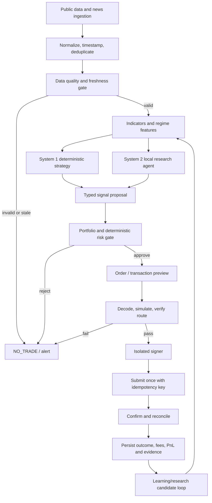
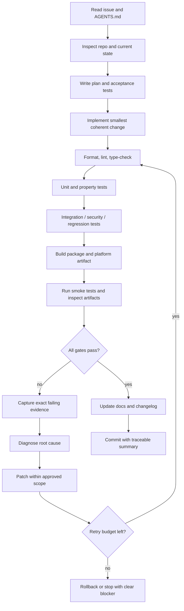

# HCS Trading Intelligence — AGENTS.md

> **Project:** HCS Trading Intelligence  
> **Publisher / credit:** Made with ❤️ by HCS.media  
> **Maintainer credit:** Made with love by timfromhcs and hcsmedia  
> **Status:** Engineering blueprint — target is a verified `v1.0.0`, not an already implemented or audited trading product  
> **Primary objective:** A local-first, self-custodial, AI-assisted and policy-bounded crypto research and spot-trading desktop application, distributed as platform-specific executable releases and Python wheels.

This file is the controlling implementation brief for coding agents. Read it before changing code. It defines product boundaries, architecture, security policy, build pipeline, testing requirements, autonomy limits, and the release gate. Do not silently weaken a requirement to make a test pass or a release ship.

---

## 0. Mission, truthfulness, and non-negotiable constraints

Build a polished HCS-branded application that runs locally, stores private state locally, exposes a documented local API and MCP interface, and can collect selected public market/news/economic feeds while connected to the internet. It should support quantitative research, paper trading, portfolio accounting, self-custody wallet adapters, and tightly bounded autonomous spot execution.

The software must be useful with no hosted HCS backend, no cloud LLM, and no subscription data service. Optional providers may require a free personal API key, impose rate limits, or offer a paid tier; the application must clearly disclose this. Public data endpoints are not a promise of unlimited throughput, completeness, freshness, or redistribution rights.

### 0.1 Never promise guaranteed profit or zero losses

No implementation can guarantee that a trading strategy will make money, that it will never lose its trading float, or that all funds will remain recoverable. Markets gap, liquidity disappears, stablecoins depeg, contracts and bridges fail, exchanges halt, keys are stolen, fees and slippage rise, and external APIs can lie or fail. A stop order is not a guaranteed exit price.

The product goal is therefore **capital preservation first, measured risk second, return-seeking third**. Never display a simulated or backtested return as an expected or guaranteed live return. Never market the application as a money-making machine, investment advisor, or risk-free wallet.

### 0.2 Cold reserve is a custody boundary, not a percentage in a config file

If the same live private key can sign transactions for every coin, a software-only “reserve percentage” cannot protect the reserve from malware, a compromised process, a vulnerable dependency, or an agent exploit. To keep a reserve outside the bot's authority:

- Use a **separate cold wallet** whose signing key is never loaded into the running application.
- The bot may control only a deliberately funded hot/trading wallet.
- Do not include cold-wallet withdrawal, sweep, seed export, or arbitrary transfer tools in the LLM/MCP tool catalogue.
- The reserve must remain outside the hot wallet's signing capability. A software balance limit alone is not equivalent.

The user can choose a reserve amount, but the system must explain that only separate custody materially isolates it from hot-wallet compromise.

### 0.3 Agents never receive signing secrets

The model and agents must never receive seed phrases, private keys, keystore passwords, raw secret material, or unrestricted signing access. The signer is a separate, narrow component. It accepts a typed transaction proposal only after the deterministic policy engine validates it. The signer must re-parse and independently validate the final transaction before signing.

### 0.4 V1 is spot-only

V1 must not implement leverage, margin borrowing, perpetuals, options, lending, auto-yield, automated staking, copy trading, or unrestricted bridge execution. Add these only through a new threat model, legal review where appropriate, dedicated tests, and an explicitly versioned feature proposal. A setting or prompt cannot bypass this rule.

### 0.5 Live execution is opt-in, bounded, and revocable

- Default mode: `PAPER`.
- Real-money mode: disabled until an operator explicitly completes a local live-trading setup and sees the exact wallet, networks, assets, spending limits, and risks.
- Once enabled, the bot may trade autonomously **only inside the preconfigured policy envelope**. “Autonomous” does not mean it can override limits, add assets, choose arbitrary contracts, withdraw funds, or grant itself permissions.
- Every order and transaction is auditable and reproducible from stored inputs, policy version, strategy version, quote, and result.
- There must be an always-available global pause / kill switch. A restart must not silently clear a triggered kill switch.

### 0.6 Offline-first is not air-gapped live data

The UI, strategy engine, database, local model, wallet logic, API, and MCP service run locally. Live prices, order books, news, political events, macro releases, quotes, and transaction broadcasts necessarily require outbound network access. Make this separation visible:

- `OFFLINE`: no network access; use local history and cached data only; no new live orders or on-chain submissions.
- `DATA_ONLY`: allowlisted read-only data/news sources; no transaction broadcast.
- `PAPER`: live external market data, simulated orders.
- `LIVE`: allowlisted data sources plus narrow exchange/RPC/DEX endpoints and the bounded signer.

A fully air-gapped mode cannot simultaneously ingest current market prices and news. Never describe the data-connected mode as fully offline.

---

## 1. Product definition and V1 scope

### 1.1 Product modules

1. **Market Intelligence:** live and historical prices, OHLCV, order-book snapshots where available, volume, spread, volatility, market breadth, asset metadata, and data-quality status.
2. **World & News Intelligence:** crypto news, financial news, politics, central-bank releases, regulatory announcements, macroeconomic data, and major world events. Every item must retain the source, canonical URL, publication time, retrieval time, language, and confidence/provenance metadata.
3. **Quantitative Research:** RSI, MACD, EMA/SMA, ATR, Bollinger Bands, volume features, trend/regime analysis, strategy versions, walk-forward backtesting, paper trading, and reports.
4. **Portfolio & Wallet:** user-owned self-custody wallet adapters and portfolio accounting for SOL, BTC, ETH, LTC, and DGB. V1 should support address/balance/transaction history and safe transaction previews for each supported chain before claiming full autonomous trading on every chain.
5. **Swap & Order Routing:** centralised-exchange spot orders through supported CCXT adapters; Solana swaps through Jupiter; EVM swaps through a separately reviewed router adapter. No universal cross-chain router is assumed. BTC/LTC/DGB direct on-chain trading or swapping must remain disabled until a tested route and signer are available.
6. **Risk & Capital Protection:** deterministic, independently tested limits; liquidity and spread checks; stale-data checks; slippage and fee bounds; drawdown stop; position limits; exposure limits; and emergency pause.
7. **Local AI Agents:** local model for research, summarisation, strategy explanations, and structured proposals. Quantitative calculations and risk decisions stay deterministic.
8. **Local API + MCP:** the same capabilities exposed through local HTTP/OpenAPI endpoints and MCP tools/resources/prompts. Every action is authorized by the same policy layer, regardless of entry point.
9. **Desktop UI/UX:** professional dashboard with charts, portfolio, news, strategy lab, trade history, risk center, agent activity, MCP/API status, wallet/network state, and logs.
10. **Distribution:** Windows single-file `.exe`, macOS app/binary package, Linux app/binary package, and Python wheels/sdist built by platform CI.

### 1.2 Supported assets and quote currencies

V1 asset registry must include at least:

- Bitcoin (`BTC`, Bitcoin mainnet)
- Ethereum (`ETH`, Ethereum mainnet)
- Solana (`SOL`, Solana mainnet-beta)
- Litecoin (`LTC`, Litecoin mainnet)
- DigiByte (`DGB`, DigiByte mainnet)
- USD Coin (`USDC`) only for explicitly registered, verified chain deployments
- Euro-denominated stablecoin support (for example EURC) only after issuer, chain, contract address, liquidity, redemption and legal/product checks have been completed.

**EUR is first a reporting/accounting currency, not automatically a token.** A fiat EUR balance held at an exchange/bank and an on-chain EUR stablecoin are distinct assets and must never share the same identifier. USDC is not the same thing as USD cash and EURC is not the same thing as an insured EUR bank deposit. Stablecoins have issuer, reserve, redemption, chain, smart-contract, liquidity, regulatory, and depeg risks.

Use a canonical asset identifier such as `chain:namespace:asset_id`, not symbol-only matching. For tokens, include chain ID, contract/mint address, decimals, issuer metadata, and source provenance. Reject unknown or lookalike token contracts by default. Do not resolve token addresses from a name or symbol supplied by an LLM.

### 1.3 Chain capability matrix (must be accurate in UI)

| Network | V1 wallet/balance scope | V1 execution scope | Primary integration direction |
|---|---|---|---|
| Bitcoin | Address, UTXO/balance, transaction status, receive | BTC/fiat or BTC/stablecoin spot via supported CEX adapter only; direct on-chain spend initially disabled unless signer and PSBT tests pass | Bitcoin Core RPC / descriptor and PSBT workflows |
| Ethereum | Account, balances, nonce, transaction status | Vetted EVM router only after simulation, allowlist and approval controls pass | `web3.py`/eth-account or a reviewed EVM client; chain ID pinned |
| Solana | Account, SOL and SPL-token balances, transaction status | Jupiter swap adapter after route, mint, program and transaction-message validation | Solana RPC + `solders`/supported SDK + Jupiter Swap API |
| Litecoin | Address, UTXO/balance, transaction status, receive | Supported CEX spot adapter only until direct-swap/PSBT integration is independently verified | Litecoin Core RPC; PSBT-style transaction workflows where supported by the exact node version |
| DigiByte | Address, balance and transaction status through a verified local/remote DigiByte Core RPC adapter | CEX spot adapter only until node and signer support is proven for the exact DGB version and address/script types | DigiByte Core JSON-RPC; no assumption that Bitcoin-specific libraries work without adaptation |

Do not claim that “one wallet library handles all five chains” unless it is actually implemented and all chain-specific tests pass. Use chain-specific adapters behind a common interface.

### 1.4 Swap reality

- Jupiter is a Solana swap route provider; it is not a universal router for BTC, LTC, DGB, Ethereum and Solana.
- Uniswap Universal Router is an EVM/ETH-and-ERC-20 router; it is not a Bitcoin, Litecoin, DigiByte or Solana router.
- A cross-chain bridge, wrapped asset, centralised exchange, atomic-swap protocol, and same-chain DEX trade are different execution/risk models. Never silently treat one as another.
- V1 may show cross-asset price comparisons and route availability without enabling cross-chain execution.
- No bridge or third-party cross-chain protocol can be added as an “easy swap” without a separate threat model, bridge-risk disclosure, contract allowlist, liquidity tests, and failure/recovery tests.

---

## 2. Reference research and implementation choices

The following are research references, not blanket endorsements. Verify the current release, license, security advisories, API changes and compatibility before pinning any dependency. Do not copy source code from a project with an incompatible license.

### 2.1 Trading engines and quantitative research

- [Freqtrade](https://github.com/freqtrade/freqtrade) — useful reference for strategy callbacks, backtesting, pairlists, dry-run, protections and parameter optimisation. Its docs explicitly include fees in backtesting and explain the need for historical candles. Use as a behaviour/design reference unless its GPL-3.0 obligations are intentionally accepted.
- [Hummingbot](https://github.com/hummingbot/hummingbot) — useful for connector patterns, market making, arbitrage and CEX/DEX connectivity. Treat market-making and high-turnover execution as later scope, not V1.
- [NautilusTrader](https://github.com/nautechsystems/nautilus_trader) — study its event-driven architecture, order lifecycle, event bus and reconciliation concepts. Consider it for a later high-throughput engine if the custom V1 core is no longer sufficient; avoid adding its complexity before profiling proves a need.
- [CCXT](https://github.com/ccxt/ccxt) — unified exchange interface. Use public-market methods first, rate limiting on, network timeouts set, and exchange-specific order/precision rules tested. A unified API does not make exchange semantics identical.
- [TA-Lib](https://github.com/TA-Lib/ta-lib-python) — candidate indicator library for RSI, MACD, moving averages, ATR, bands and more. Verify native wheel availability and package license for every target OS/architecture. Implement a small pure-Python reference RSI in tests so TA-Lib output can be cross-checked.
- [vectorbt](https://github.com/polakowo/vectorbt) — candidate research/backtesting tool. Review the current edition and license before including it in the distributable. It may be an optional research extra rather than a mandatory runtime dependency.

### 2.2 Market data / macro / news sources

- [CoinGecko API](https://www.coingecko.com/en/api) — useful aggregated prices, market caps and metadata. The current Demo offer is free but quota-limited; the published free Demo plan advertises 100 calls/minute and a monthly cap. Cache and batch; do not poll every coin independently each second.
- [Binance public market-data endpoints](https://github.com/binance/binance-spot-api-docs) — market-data-only REST/WebSocket endpoint domains are documented as unauthenticated. Check jurisdictional availability, exchange terms and current rate limits. A public quote endpoint is not a commitment to provide a working trading account in every country.
- [Kraken Spot API](https://docs.kraken.com/api/) — public REST and WebSocket market-data streams; public endpoints do not require an authenticated private account feed. Respect endpoint-specific public/private/trading rate limits.
- [GDELT DOC 2.0](https://blog.gdeltproject.org/gdelt-doc-2-0-api-debuts/) — broad news search and event/media monitoring. Treat it as discovery and coverage information, not a verified truth feed. Preserve article URLs and source-level metadata.
- [FRED API](https://fred.stlouisfed.org/docs/api/fred/) — US macro/economic series. It requires a registered API key and has terms of use; do not call it “keyless”.
- [ECB Data Portal SDMX services](https://data.ecb.europa.eu/help/getting-data-web-services-sdmx-0) — official euro-area statistics and exchange-rate data through SDMX web services.
- Official RSS / release pages to add as configurable sources: ECB, Deutsche Bundesbank, Federal Reserve, US Treasury, SEC, ESMA, European Commission, Eurostat, BaFin, national statistics offices and relevant government/central-bank releases.
- For news, prefer licensed RSS/official releases and public APIs. Do not scrape paywalled sites or bypass robots, authentication, or site terms. “Available in a browser” does not mean “licensed for unrestricted automated republication”.

### 2.3 Wallets, swaps and chain signing

- [Solana security guidance](https://solana.com/docs/tools/security) — key isolation, separation of hot and cold wallets, backups, distinct devnet/mainnet keys and RPC endpoint protection.
- [Solana signing in production](https://solana.com/docs/core/transactions/signing-in-production) — compare local keypair, hardware wallet and KMS signing patterns; never ship keys in frontend or source.
- [Solana transactions](https://solana.com/docs/core/transactions) — transaction size, atomic execution, signature and blockhash properties; a transaction can fail and still cost fees.
- [Jupiter Swap API](https://dev.jup.ag/docs/swap) — use the current official Swap API route and documentation, not old examples copied from blog posts. Verify the current v2 endpoint, fee behaviour and transaction submission design before implementation.
- [Uniswap Universal Router](https://developers.uniswap.org/docs/protocols/universal-router/overview) — EVM router command structure and token/approval implications.
- [Bitcoin Core descriptors](https://github.com/bitcoin/bitcoin/blob/master/doc/descriptors.md) and [Bitcoin Core PSBT](https://github.com/bitcoin/bitcoin/blob/master/doc/psbt.md) — descriptor-based wallet and partially signed transaction workflows.
- [Litecoin Core PSBT notes](https://github.com/litecoin-project/litecoin/blob/master/doc/psbt.md) — inspect and test exact version support, script types and interoperability.
- [Ethereum accounts](https://ethereum.org/developers/docs/accounts) and [security guidance](https://ethereum.org/security) — key custody, transaction review and allowance limits.
- [DigiByte Core](https://github.com/DigiByte-Core/digibyte) — use the upstream node/client and verified JSON-RPC methods for the exact supported release. Do not assume a BTC library will sign DGB transactions correctly just because both use UTXO concepts.

### 2.4 MCP, API and agent orchestration

- [Official MCP specification](https://modelcontextprotocol.io/specification) and [official Python SDK](https://py.sdk.modelcontextprotocol.io/) — use a pinned, compatible stable SDK line. The current official Python SDK v2 requires Python 3.11+; verify its migration guide before upgrading from v1.
- [FastMCP](https://github.com/jlowin/fastmcp) — optional high-level Python MCP layer. Choose either the official SDK directly or FastMCP after a spike; avoid duplicate protocol stacks in the same server.
- [MCP security best practices](https://modelcontextprotocol.io/docs/tutorials/security/security_best_practices) — implement authorization, token audience validation where applicable, least privilege and safe resource handling.
- [OWASP LLM Prompt Injection Prevention](https://cheatsheetseries.owasp.org/cheatsheets/LLM_Prompt_Injection_Prevention_Cheat_Sheet.html) — treat web/news/tool output as untrusted content; validate tool arguments and authorize actions in deterministic code outside the model.
- [LangGraph](https://github.com/langchain-ai/langgraph) is a possible later orchestration runtime for long-running, checkpointed workflows. V1 can use explicit, persisted state machines and avoid an orchestration framework dependency until needed.
- [FastAPI](https://fastapi.tiangolo.com/) — local REST interface, Pydantic schemas, OpenAPI schema and interactive docs. Bind to loopback by default.

### 2.5 Local model / offline inference

- [llama.cpp](https://github.com/ggml-org/llama.cpp) — candidate GGUF local inference runtime, OpenAI-compatible server mode, quantization, CPU fallback, Vulkan and Metal backends. It supports hybrid CPU/GPU offload; the exact performance depends on model, quantization, context, driver and hardware.
- Model adapter must be provider-agnostic: llama.cpp first, with optional Ollama/other local runtime adapters later. No external cloud model is required by default.
- A local model file must be downloaded separately, have its license and SHA-256 verified, and be selected by the user. Do not silently bundle multi-gigabyte model weights into the executable.
- The phrase/model name **“OpenJEV” / “System One JEV” could not be reliably matched to an established, verifiable public model or project during the research for this plan.** Do not invent a model repository or claim it is trained. Keep it as a pluggable adapter/model alias pending a canonical URL. V1 should work with no model installed.
- RSI is calculated deterministically from market data. Feed its structured values, period, timeframe, warm-up status and source candles to the LLM; do not claim the LLM itself has RSI “built in” unless a verifiable model implementation actually does.

### 2.6 Build, package and supply chain

- [PyInstaller](https://pyinstaller.org/en/stable/) — good first candidate for a single-file executable. It is **not a cross-compiler**: build Windows on Windows, macOS on macOS and Linux on Linux. One-file mode extracts bundled libraries into a temporary directory and can start more slowly; debug and validate one-folder mode first.
- [Nuitka](https://nuitka.net/user-documentation/user-manual.html) — benchmark as an alternative compiler/package path after a working reference build. Validate standalone mode before onefile.
- [cibuildwheel](https://cibuildwheel.pypa.io/en/stable/) — build and test wheels across supported Python versions, Linux, Windows and macOS in CI.
- [Python Packaging User Guide](https://packaging.python.org/en/latest/guides/tool-recommendations/) — use `pyproject.toml`, modern build frontends and declared build backends; do not call deprecated direct `setup.py` packaging commands.
- [GitHub Actions Python CI](https://docs.github.com/en/actions/tutorials/build-and-test-code/python), [workflow hardening](https://docs.github.com/en/actions/how-tos/secure-your-work) and [artifact attestations](https://docs.github.com/en/actions/how-tos/secure-your-work/use-artifact-attestations/use-artifact-attestations) — build matrix, minimal permissions, immutable action references, provenance and SBOM.
- [OpenSSF Scorecard](https://scorecard.dev/) — automate checks of repository supply-chain hygiene.
- [Hypothesis](https://hypothesis.readthedocs.io/) — property-based testing for numeric and parser edge cases.

---

## 3. Architecture principles

### 3.1 Local-first modular monolith first

Build a modular monolith with stable internal interfaces, not a microservice mesh. One executable starts the API, agent scheduler, data loops, MCP server entrypoints and UI shell. Keep modules isolated and dependency-injected so that a future process split is possible without requiring it for V1.

Use one canonical application state and one policy enforcement path. Do not duplicate business logic in the GUI, MCP layer, REST endpoints, agents and wallet adapters.

### 3.2 Recommended technology baseline

Pin tested versions in lockfiles; these are technology choices, not hard-coded minimum versions to leave stale forever.

| Area | Preferred implementation | Notes |
|---|---|---|
| Language | Python 3.12 baseline; test 3.13 when dependencies support it | MCP SDK v2 requires Python 3.11+; choose 3.12 for a conservative cross-platform runtime baseline |
| Package/build | `pyproject.toml`, `uv` for dev/lock, `hatchling` or setuptools build backend | Publish sdist plus compatible wheels; no direct `setup.py` build commands |
| API | FastAPI + Pydantic v2 + Uvicorn | `/api/v1`, OpenAPI, strict request/response validation |
| MCP | Official MCP Python SDK v2 OR FastMCP, selected after a small integration spike | One implementation; stdio plus loopback Streamable HTTP if supported by selected SDK |
| Frontend | React + TypeScript + Vite | Build static assets and serve locally from the executable |
| UI components | Tailwind CSS + shadcn/ui-style accessible primitives + Lucide icons | Avoid giant component kit and inaccessible custom controls |
| Charts | Apache ECharts or TradingView Lightweight Charts after license/attribution review | Candle/volume/indicator overlays and accessible fallbacks |
| Data state | SQLite + SQLAlchemy 2 + Alembic | WAL, foreign keys, migration tests, local backup/export |
| HTTP | `httpx` async client | Timeouts, retry budgets, backoff, circuit breakers |
| Exchange connectivity | CCXT for supported exchange adapters | Keep native exchange clients where CCXT semantics are insufficient |
| Indicators | TA-Lib where wheels are available + pure-Python reference implementations for core indicators | Avoid forcing a native build to be installed by every user |
| Local model | llama.cpp GGUF subprocess or embedded library behind `LocalModelProvider` | Optional feature; CPU-safe fallback; never an execution authority |
| Security | OS keychain/credential store + encrypted local keystore; audited crypto libraries only | Never write custom cryptography |
| Tests | pytest, pytest-asyncio, Hypothesis, respx/httpx mocks | Unit, integration, regression, chaos, packaging and security gates |
| Observability | structlog or stdlib structured logging + local metrics endpoint | Redact all secrets; correlation IDs across every loop |

Avoid adding Docker as a runtime requirement. Docker may be used optionally in CI or for isolated integration services, but ordinary local installation and execution must work without it.

### 3.3 Suggested repository layout

```text
hcs-trading-intelligence/
├── AGENTS.md
├── README.md
├── LICENSE
├── SECURITY.md
├── CONTRIBUTING.md
├── CODE_OF_CONDUCT.md
├── CHANGELOG.md
├── pyproject.toml
├── uv.lock
├── .python-version
├── .gitignore
├── .editorconfig
├── .pre-commit-config.yaml
├── .github/
│   ├── ISSUE_TEMPLATE/
│   ├── PULL_REQUEST_TEMPLATE.md
│   ├── dependabot.yml
│   └── workflows/
│       ├── ci.yml
│       ├── security.yml
│       ├── wheel-build.yml
│       ├── desktop-build.yml
│       ├── release.yml
│       └── scorecard.yml
├── docs/
│   ├── ARCHITECTURE.md
│   ├── THREAT_MODEL.md
│   ├── DATA_SOURCES.md
│   ├── WALLET_SECURITY.md
│   ├── API.md
│   ├── MCP.md
│   ├── STRATEGY_RESEARCH.md
│   ├── BACKTESTING.md
│   ├── RELEASE.md
│   ├── ADR/
│   └── diagrams/
├── frontend/
│   ├── package.json
│   ├── vite.config.ts
│   ├── src/
│   └── dist/                 # build output, included in package
├── src/hcs_trader/
│   ├── __init__.py
│   ├── __main__.py
│   ├── bootstrap.py
│   ├── config/
│   ├── domain/
│   ├── application/
│   ├── api/
│   ├── mcp/
│   ├── agents/
│   ├── skills/
│   │   ├── market-research/SKILL.md
│   │   ├── strategy-lab/SKILL.md
│   │   ├── portfolio-operator/SKILL.md
│   │   ├── risk-auditor/SKILL.md
│   │   └── release-engineer/SKILL.md
│   ├── data/
│   │   ├── providers/
│   │   ├── ingestion/
│   │   ├── normalization/
│   │   └── quality/
│   ├── news/
│   ├── quant/
│   │   ├── indicators/
│   │   ├── strategies/
│   │   ├── backtesting/
│   │   └── evaluation/
│   ├── portfolio/
│   ├── risk/
│   ├── execution/
│   ├── exchanges/
│   ├── wallets/
│   │   ├── common/
│   │   ├── bitcoin/
│   │   ├── ethereum/
│   │   ├── solana/
│   │   ├── litecoin/
│   │   └── digibyte/
│   ├── signing/
│   ├── storage/
│   ├── scheduler/
│   ├── observability/
│   └── ui_assets/
├── tests/
│   ├── unit/
│   ├── property/
│   ├── contract/
│   ├── integration/
│   ├── replay/
│   ├── security/
│   ├── chaos/
│   └── packaging/
├── scripts/
│   ├── dev.py
│   ├── build_frontend.py
│   ├── build_desktop.py
│   ├── build_wheels.py
│   ├── verify_release.py
│   └── generate_sbom.py
└── installer/                # optional signed installers and platform metadata
```

### 3.4 Domain boundaries

- `domain/`: pure types, invariants, money/quantity types, asset identity, portfolio and order state models. No HTTP, database or LLM imports.
- `application/`: use cases / orchestration; calls domain rules and ports.
- `data/`: provider adapters, ingestion, normalization, caching and data-quality checks.
- `quant/`: indicators, strategy implementations, backtest and evaluation.
- `risk/`: deterministic risk policy and kill switch. Must not import an LLM client.
- `execution/`: order planning, routing, lifecycle and reconciliation. No direct secret access.
- `signing/`: isolated signing interface. Only accepts validated, typed transaction plans; no generic “sign arbitrary bytes” MCP tool.
- `wallets/`: chain-specific balance/address/transaction clients and transaction decoders.
- `agents/`: agent roles and state machines; use application ports, never raw network clients or signer internals.
- `api/` and `mcp/`: thin transport adapters. They must call the exact same application use cases and policies.

### 3.5 Event model

Use immutable, versioned internal events with stable IDs and UTC timestamps. Examples:

- `MarketQuoteReceived`
- `CandleClosed`
- `OrderBookSnapshotReceived`
- `NewsArticleIngested`
- `MacroReleasePublished`
- `FeatureSetCalculated`
- `StrategySignalProposed`
- `RiskDecisionMade`
- `OrderPreviewCreated`
- `OrderSubmitted`
- `OrderAcknowledged`
- `OrderPartiallyFilled`
- `OrderFilled`
- `OrderRejected`
- `ChainTransactionBroadcast`
- `ChainTransactionConfirmed`
- `ChainTransactionFailed`
- `PortfolioReconciled`
- `KillSwitchTriggered`

Persist state transitions and event references. Prefer an outbox/inbox pattern and idempotent consumers. Never assume one network response maps one-to-one to one trade outcome.

---

## 4. Market, news and economic data loops

### 4.1 Provider interface

Create a provider contract similar to:

```python
class MarketDataProvider(Protocol):
    async def get_quote(self, asset: AssetId, quote: AssetId) -> Quote: ...
    async def get_ohlcv(self, market: MarketId, timeframe: Timeframe,
                        start: datetime, end: datetime) -> Sequence[Candle]: ...
    async def stream_quotes(self, markets: Sequence[MarketId]) -> AsyncIterator[Quote]: ...
    async def health(self) -> ProviderHealth: ...
```

Provider implementations must not leak provider-specific payloads into the strategy engine. Normalize timestamps, decimal precision, market identifiers, volume units and error types at the edge.

### 4.2 Data-loop rules

Each loop must:

1. Read an explicit list of enabled sources and assets.
2. Respect provider request quotas and endpoint-specific limits.
3. Use WebSocket streaming where it materially improves freshness; use REST snapshots for bootstrap and reconciliation.
4. Batch requests and cache reusable responses.
5. Use exponential backoff with jitter and a maximum retry budget.
6. Open a circuit breaker after repeated failures; do not hammer a failed service.
7. Record provider timestamp, local receipt timestamp, source and sequence/update ID where available.
8. Reject malformed, non-finite, negative or implausible values.
9. Detect duplicates, gaps, stale feeds, crossed/locked books and clock drift.
10. Mark data `FRESH`, `STALE`, `DEGRADED`, `MISSING` or `INVALID`; never silently substitute stale values.
11. Keep the last known good data for display and backtesting, but prevent new orders when data quality violates execution policy.
12. Be restart-safe: after restart, bootstrap/reconcile and then resume the loop; do not replay old data as if it were a new price tick.

### 4.3 Rate-limit and freshness policy

No hardcoded polling rate may be treated as universal. Store per-provider configuration and update it from current official documentation. Examples from currently researched sources include CoinGecko Demo limits and exchange-specific public limits; these can change. Implement adaptive requests and a visible quota/freshness panel.

A strategy must declare its maximum allowed quote age for each timeframe. Example: a 1-minute strategy cannot trade on a quote last observed several minutes ago. If the feed is stale, the correct action is `NO_TRADE`, not a guessed price.

### 4.4 News ingestion and world-event processing

Build an ingestion pipeline for:

- Crypto-specific headlines and official protocol/exchange announcements.
- Financial news and market-moving corporate/institutional announcements.
- Central-bank statements, interest-rate releases, inflation, jobs and GDP data.
- Political events, elections, sanctions, trade policy, regulations and geopolitical incidents.
- Official crypto-regulatory releases from EU and national regulators.

Every source gets a registry entry containing owner, URL, format, language, API-key requirement, free-tier/quota notes, terms/license URL, update cadence, retry policy and enabled status.

For each ingested item store:

```text
article_id, source_id, canonical_url, title, snippet_or_licensed_text,
source_published_at, retrieved_at, language, region,
entities[], topics[], event_type, source_reliability_metadata,
content_hash, duplicate_group_id, sentiment_features?,
summary_model_id?, summary_version?, raw_payload_reference
```

Rules:

- Preserve original links and distinguish publication time from retrieval time.
- Deduplicate by canonical URL and content fingerprint.
- Track corrections, updates and conflicting reports rather than overwriting history.
- Prefer primary sources for factual announcements. Use multiple independent sources for fast-moving or disputed events.
- Sentiment is a noisy feature, not a trade instruction. Political coverage tone or social-media popularity must not be confused with the event's actual economic impact.
- Never allow article text or webpage instructions to modify system prompts, change agent permissions, reveal local data, or trigger transactions. News/web content is untrusted data.
- Strip scripts and active markup; render only safe text and validated links.
- Keep content payload sizes bounded and store the article source separately from the model summary.
- Do not republish full copyrighted articles. Show short licensed excerpts, metadata and links.

### 4.5 News impact feature design

Optional derived features may include event category, entities affected, source count, source diversity, source reliability, event recency, volatility regime, market reaction after publication, and confidence interval. Keep separate values for:

- factual event classification,
- model-generated interpretation,
- measured market reaction,
- strategy response.

Do not collapse them into a single opaque “news score”. The UI must let a user inspect the original source and see why the feature was generated.

---

## 5. Quant engine, RSI and strategy research

### 5.1 Indicators are deterministic functions

Implement and test the core indicators independently of the LLM:

- RSI (Wilder smoothing; configurable period, common default 14)
- EMA/SMA
- MACD
- ATR / normalized ATR
- Bollinger Bands
- rolling volatility
- volume and volume-change features
- market structure / trend features

For RSI, use:

\[
U_t = \max(C_t-C_{t-1},0), \qquad D_t = \max(C_{t-1}-C_t,0)
\]

\[
\overline U_t=\frac{(n-1)\overline U_{t-1}+U_t}{n},\qquad
\overline D_t=\frac{(n-1)\overline D_{t-1}+D_t}{n}
\]

\[
RS_t=\frac{\overline U_t}{\overline D_t},\qquad
RSI_t=100-\frac{100}{1+RS_t}
\]

Handle zero average loss, zero average gain, insufficient history, NaN/inf, duplicate candles, gaps and flat price series explicitly. RSI(14) requires sufficient price changes/warm-up; do not display a made-up value before warm-up is complete. Tests must define exact expected behaviour for edge cases.

### 5.2 “System 1 / System 2” agent pattern

Implement two distinct reasoning paths:

**System 1 — fast deterministic engine**
- consumes clean quotes/candles and precomputed features,
- evaluates fixed strategy rules and thresholds,
- generates typed `SignalProposal` objects,
- uses no free-form LLM output to decide position size or bypass risk,
- must complete inside strategy-specific latency budgets.

**System 2 — slower research and explanation agent**
- uses the local GGUF model when installed,
- reviews trend regime, indicators, news context, portfolio concentration and historical strategy results,
- produces a structured thesis, uncertainty, citations/source IDs and a proposed action or `NO_TRADE`,
- can recommend strategy changes only into a sandbox/challenger version,
- cannot call the signer or mutate the active strategy version.

A structured signal may contain `direction`, `market`, `timeframe`, `entry_conditions`, `invalidation`, `confidence` (clearly defined, not a probability unless calibrated), `evidence_ids`, `data_quality`, `strategy_version` and `expires_at`. The risk engine makes the only final authorization decision.

### 5.3 Model adapter

Create `LocalModelProvider` with methods for health, metadata, structured completion and optional embeddings. Provide a `NoneModelProvider` so all non-AI features work without a model. For llama.cpp:

- run local only, preferably bound to `127.0.0.1`, with authentication/random local token if HTTP is used;
- support a GGUF path chosen by the user; verify SHA-256 and license metadata;
- allow CPU-only fallback and configurable GPU offload; do not assume CUDA;
- cap context and generation tokens to avoid memory exhaustion;
- use JSON schema / grammar constrained output where supported;
- validate all returned JSON with Pydantic and reject extra/invalid fields;
- record model file hash, quantization, runtime version, prompt template version and generation parameters;
- do not silently download weights at startup;
- no telemetry or cloud fallback without explicit opt-in.

The executable must remain small enough to distribute. Model weights are separate optional downloads with versioned manifest and checksum.

### 5.4 Strategy interface

```python
class Strategy(Protocol):
    strategy_id: str
    version: str
    def warmup_requirements(self) -> WarmupRequirements: ...
    def evaluate(self, market_state: MarketState,
                 portfolio_state: PortfolioState) -> SignalProposal: ...
    def explain(self, signal: SignalProposal) -> StrategyExplanation: ...
```

Active strategy versions are immutable. A research agent may create `candidate` versions; only the strategy promotion pipeline may mark a version `approved`. Every promotion stores experiment data, test dataset hashes, source commit, parameters and evaluation report.

### 5.5 Backtesting requirements

Backtesting must model:

- maker/taker and tiered fees where known,
- bid/ask spread, slippage and partial fills,
- minimum order size and exchange precision,
- latency and quote/candle publication time,
- gas/network fees and failed-transaction fees where applicable,
- liquidity/volume constraints and market impact approximations,
- asset listing/delisting and symbol changes,
- quote-currency conversion and stablecoin depeg scenarios,
- realistic stop execution and gap risk,
- position sizing and capital constraints.

Prevent:

- look-ahead bias,
- survivorship bias,
- leakage across training/test periods,
- use of revised economic data as if it were known historically,
- parameter overfitting to the final holdout,
- accidental mixing of candle-close and intrabar signals.

Use chronological train/validation/test splits and walk-forward analysis. Keep the final holdout sealed until a strategy candidate is frozen. Add Monte Carlo/bootstrap stress tests and compare to sensible passive benchmarks. Report net-of-cost returns, drawdown, Sharpe/Sortino with assumptions, Calmar, trade count, exposure, turnover, win/loss distribution, expectancy, fees, slippage assumptions and worst periods. A profitable backtest alone never authorizes live trading.

### 5.6 Strategy promotion ladder

`RESEARCH -> UNIT_TESTED -> BACKTESTED -> WALK_FORWARD_PASSED -> PAPER_SHADOW -> PAPER_APPROVED -> LIVE_CANARY -> LIVE_BOUNDED`

A candidate fails promotion if it does not meet predeclared gates, if tests are not reproducible, if data quality is incomplete, if the final holdout is contaminated, or if live/paper behaviour diverges unexpectedly. Do not automatically tune a live strategy to chase recent losses.

---

## 6. Portfolio, wallets, signing and swaps

### 6.1 Common wallet port

```python
class ChainWallet(Protocol):
    async def get_addresses(self) -> Sequence[WalletAddress]: ...
    async def get_balances(self) -> Sequence[ChainBalance]: ...
    async def get_transaction(self, tx_id: str) -> ChainTransaction | None: ...
    async def build_preview(self, intent: TransferOrSwapIntent) -> UnsignedTransaction: ...
    async def simulate(self, tx: UnsignedTransaction) -> SimulationResult: ...
    async def broadcast(self, signed_tx: SignedTransaction) -> BroadcastResult: ...
    async def health(self) -> ChainHealth: ...
```

The common port does not erase chain-specific semantics. Every adapter has its own decoder, address validation, decimal handling, fee model, transaction simulation and test vectors.

### 6.2 Key storage and signer design

- Use established audited wallet/cryptography libraries; never implement elliptic-curve signing, derivation, mnemonic handling, encryption or nonce generation from scratch.
- Prefer hardware-backed or operating-system credential storage where possible. For a local software keystore, encrypt seeds with a memory-hard KDF and authenticated encryption from a maintained library; record KDF parameters and salt. Keep the master password out of environment dumps and logs.
- A decrypted key should exist only inside the narrow signer process/component for the shortest possible time. Python cannot promise perfect zeroization; do not claim that it can.
- Do not store secrets in source control, frontend assets, `.env` committed to Git, build artifacts, crash dumps, logs, analytics, MCP context or model prompts.
- Do not place a wallet seed, passphrase or a mainnet private key into CI. CI uses synthetic keys and devnet/testnet/regtest fixtures only.
- For each chain and network, use distinct test and mainnet keys. Never import a mainnet seed into CI or tests.
- Seed creation/import/export must be a local wallet-only flow with clear backups, checksum/word confirmation and no clipboard logging. Exports must never be offered through MCP.
- Keep a documented recovery/export procedure that is not executable by agents.

### 6.3 Signer policy contract

The signer accepts only `ValidatedTransactionPlan` carrying:

- canonical chain ID and network,
- wallet ID and expected signer address,
- asset IDs and exact input/output amounts,
- destination/program/router IDs,
- token mint/contract IDs,
- min-output and max-slippage,
- max network fee and priority fee,
- expiry/deadline/nonce constraints,
- simulation result and block/reference data,
- risk decision ID and policy version,
- idempotency key and plan hash.

The signer independently checks all fields, checks the transaction decoder against the declared plan, rejects unknown program/contract IDs, rejects arbitrary transfers and unbounded approvals, and signs only if the active policy still allows the request. Do not trust the LLM's summary of the transaction; decode the bytes.

### 6.4 Hot-wallet and reserve defaults

Use conservative configuration defaults as an initial safety envelope, not as financial advice:

- `PAPER` by default.
- `LIVE` off by default.
- no leverage or borrowed funds.
- separate cold reserve; no cold key in the application.
- optional policy default: no more than 10% of total intended portfolio value in the bot-controlled hot trading wallet; the rest remains in cold custody. Let the operator configure the actual amount.
- optional policy default: per-trade risk budget no more than 0.25% of hot trading equity, measured to the defined invalidation/stop point plus estimated costs.
- optional policy default: pause at 1% daily hot-wallet equity loss and 5% peak-to-trough hot-wallet drawdown pending operator review.
- optional policy default: spot only, maximum two simultaneous positions until correlation/exposure logic is validated.
- no trade if order size is below minimum, fees dominate expected edge, liquidity is inadequate or slippage exceeds cap.

These are starter defaults for the product's configuration layer. They are not optimal for every asset/timeframe and must be labelled as configurable safety examples. The kill switch and reserve isolation cannot be disabled by a model. All risk thresholds must be validated before enabling LIVE.

### 6.5 Position size calculation

Use a deterministic calculation. For a long spot position, a simple starting upper bound is:

```text
risk_budget = hot_equity * risk_fraction
risk_per_unit = entry_price - invalidation_price + estimated_cost_per_unit
quantity_by_risk = risk_budget / risk_per_unit
quantity_by_cap = max_position_notional / entry_price
quantity_by_cash = available_quote_balance / entry_price
quantity = min(quantity_by_risk, quantity_by_cap, quantity_by_cash)
```

Reject the proposal if `risk_per_unit <= 0`, any input is stale/invalid, quantity violates precision/minimums, projected portfolio exposure exceeds its limit, or a risk metric cannot be computed. Include correlation/concentration caps across correlated assets. Do not size solely from LLM confidence.

### 6.6 Solana/Jupiter transaction checks

Before signing a Jupiter route:

- confirm network is mainnet-beta only when LIVE is explicitly enabled;
- verify exact input/output mint addresses and decimal metadata;
- reject unknown tokens and suspicious mint metadata;
- verify supported route/program IDs against a versioned allowlist;
- inspect all instructions, accounts and program invocations;
- verify the transaction has not changed since simulation/preview;
- enforce min received, max slippage, max priority fee and max transaction fee;
- simulate and reject errors, unexpected account changes, unknown instructions or unexplained token approvals;
- check quote age and route liquidity;
- account for fees even when a transaction fails;
- persist the signed message hash and resulting signature;
- reconcile final balances and token deltas after confirmation.

Solana fees can still be charged when an instruction fails; do not assume failure is free.

### 6.7 EVM transaction checks

- pin expected `chainId`; reject wrong-chain or forked RPC state;
- allowlist exact router/contract addresses and code hashes where practical;
- decode calldata and verify recipient, token, input amount, minimum output, deadline and method;
- simulate against the latest state and estimate gas;
- cap max fee and gas limit;
- use exact/short-lived token approvals; never grant unlimited allowance by default;
- verify allowance state before/after and provide a revoke-approval flow;
- reject unexpected delegate calls, proxy upgrades or contracts outside the audited allowlist;
- store tx hash, nonce, simulation, receipt, logs and final asset deltas.

### 6.8 Bitcoin / Litecoin / DigiByte UTXO handling

- Keep UTXOs, change output, fees, address derivation and script types chain-aware.
- Use descriptor-based wallets and PSBT where the exact node implementation supports it; validate Litecoin and DigiByte individually rather than assuming Bitcoin compatibility.
- Detect dust, change address reuse, fee spikes, UTXO lock/spend conflicts and reorg/confirmation state.
- Avoid embedding a full blockchain node in the single-file executable for V1. Connect to a configured local node or a user-selected trusted endpoint. Warn that a public explorer is a third party and may see queried addresses.
- Do not broadcast a transaction if the node is unsynced, chain identity is wrong or fee estimation is stale.

### 6.9 Trading venues and exchange API credentials

- Use CCXT or direct exchange APIs only for explicitly supported, currently verified venues.
- Request the minimum API scopes. For exchange credentials, disable withdrawals and transfers; use read and spot-trade scopes only if the venue supports them.
- Store keys in OS credential storage or encrypted settings; never put them in React state persisted to disk as plaintext.
- Add per-venue order precision, min-size, symbol mapping, fee tier, rate-limit, maintenance and account restrictions.
- Use a stable client order ID for idempotency where supported. Before retrying a timeout, query whether the first order actually exists.
- Reconcile local order state against venue state at startup and after every ambiguous response.
- No margin/perpetuals/futures in V1.

---

## 7. Deterministic risk engine

The risk engine is a separate, testable module. Neither the LLM, strategy plugin, MCP client nor UI can override it.

### 7.1 Pre-trade checks

Every order must pass every applicable rule:

1. LIVE mode enabled by operator and policy.
2. Global/system kill switch is clear.
3. Wallet/network/venue health is healthy and reconciled.
4. Price, candles, quote and news features are within configured freshness windows.
5. Market is allowlisted and tradable; token/router contract is allowlisted.
6. Strategy version is approved for this mode.
7. Asset precision, min/max order, available balance and fee reserve are valid.
8. Projected order size fits per-trade, per-asset and total-exposure caps.
9. Risk to invalidation/stop is within budget.
10. Projected daily loss, current drawdown and consecutive-loss protections are not breached.
11. Spread, depth, impact and expected slippage are within limits.
12. Fees and gas do not exceed their budget or consume the expected edge.
13. Quote/route is not expired and is within price-deviation constraints.
14. No unresolved duplicate/ambiguous order or pending transaction exists for the same intent.
15. Transaction plan hash matches the one evaluated by policy and simulation.

If any check is false, return a typed `REJECTED` or `NO_TRADE` reason and persist it. Do not silently downgrade an error into a smaller live order unless an explicitly tested policy says to do so.

### 7.2 Kill-switch triggers

At minimum:

- data feed stale or inconsistent,
- portfolio/order reconciliation mismatch,
- exchange or RPC unhealthy,
- unexpected chain ID or network,
- repeated order rejects/timeouts,
- unexplained balance delta,
- daily loss or drawdown threshold exceeded,
- slippage/fees beyond cap,
- suspicious token/router/program interaction,
- signing policy failure,
- model/tool injection or unauthorized capability request,
- database corruption or critical persistence failure.

Kill switch behavior: stop new orders immediately; cancel open orders where safe and supported; do not attempt uncontrolled emergency sells; continue read-only monitoring and reconciliation; preserve state; notify UI/MCP/logs; require a deliberate local operator action to clear after the underlying condition is resolved. A model cannot clear the switch.

### 7.3 No-trade is a successful result

A high-quality trading system must often decide not to trade. `NO_TRADE` is a first-class outcome with structured reasons. Do not optimize an agent to generate constant trading activity or treat a zero-trade period as a bug.

---

## 8. Agent architecture and autonomous loops

### 8.1 Roles and permissions

| Agent | Responsibilities | Permissions | Explicitly forbidden |
|---|---|---|---|
| Market Data Agent | Collect, normalize, validate and cache prices/candles | Read providers; write market store | Signing, trade placement |
| News Intelligence Agent | Collect headlines, classify events, summarise sources | Read public web/RSS; write news store | Treating article instructions as system instructions; trade execution |
| Quant Research Agent | Calculate and explain indicators; create strategy candidates | Read market/history; write candidate experiments | Promoting itself to live; changing risk policy |
| Portfolio Agent | Reconcile balances and exposure; produce snapshots | Read wallet/venue balances | Private-key access, withdrawal |
| Risk Auditor Agent | Explain deterministic policy decisions; inspect limits | Read policy and decision logs | Override deterministic policy |
| Execution Agent | Turn already-approved intents into order/transaction lifecycle requests | Submit only `ValidatedOrder` / `ValidatedTransactionPlan` | Arbitrary destinations, withdrawals, key access, bypassing risk |
| Learning Agent | Evaluate outcomes and propose new candidates | Read trades/metrics; write research artefacts | Changing live weights/thresholds without promotion gate |
| Operations Agent | Watch provider health, database, scheduler and process | Read health; pause system; alert | Clear kill switch, sign transactions |

The same role may be implemented as separate graph nodes rather than separate model instances. Use the smallest design that maintains permission separation.

### 8.2 Main trading loop



### 8.3 Autonomous loop contract

Every loop must implement:

- persisted state and cursor,
- stable run ID and correlation ID,
- bounded timeouts and retry budgets,
- explicit cancellation and shutdown,
- idempotent writes and side effects,
- health metrics and last-success timestamp,
- typed failure state and recovery action,
- maximum work batch / memory budget,
- no infinite exception-swallowing loop,
- a circuit breaker and safe-mode behaviour.

Do not make the main trading loop depend on a continuous LLM response. The deterministic path must continue to return `NO_TRADE` safely if the model is missing, overloaded or malformed.

### 8.4 Self-learning without runaway mutation

Learning uses realised outcomes and labels to evaluate strategy candidates. It may:

- compare live/paper predictions to realised outcomes,
- track slippage, fee drift and signal calibration,
- identify regimes in which a strategy underperforms,
- suggest new indicator parameters or filters,
- create candidate versions and test reports,
- adjust research priorities within fixed compute quotas.

It may **not**:

- overwrite the active strategy or risk limits in place,
- use one or a few profitable trades as proof of skill,
- expand wallet permissions or supported assets,
- retrain on data that leaks from the sealed holdout,
- automatically increase risk following wins,
- chase losses by increasing size,
- rewrite its own source code and immediately execute that rewrite in LIVE.

Use champion/challenger strategy versions, fixed evaluation windows, immutable experiment metadata, walk-forward checks and paper-shadow promotion. A changed model or prompt is a changed system and must have regression/security evaluation.

---

## 9. MCP, REST API and agent Skills

### 9.1 One application service, multiple transports

REST, MCP, GUI and command-line clients must call the same `application/` use cases. Never implement a second order-placing path inside an MCP tool.

Default binding:

- REST: `127.0.0.1` only; never `0.0.0.0` by default.
- MCP stdio: preferred for local AI tools where possible.
- MCP Streamable HTTP: loopback only, random local auth token, explicit client registration/permission, request limits.
- Remote access: disabled in V1 unless a separately reviewed TLS/authentication/authorization design is added.

### 9.2 REST endpoints (initial contract)

```text
GET    /api/v1/health
GET    /api/v1/system/status
GET    /api/v1/system/capabilities
GET    /api/v1/market/assets
GET    /api/v1/market/quotes
GET    /api/v1/market/candles
GET    /api/v1/market/orderbook
GET    /api/v1/news/search
GET    /api/v1/news/events
GET    /api/v1/macro/series
GET    /api/v1/portfolio/summary
GET    /api/v1/portfolio/positions
GET    /api/v1/wallets
GET    /api/v1/wallets/{wallet_id}/balances
GET    /api/v1/wallets/{wallet_id}/transactions
GET    /api/v1/strategies
GET    /api/v1/strategies/{strategy_id}/metrics
POST   /api/v1/backtests
GET    /api/v1/backtests/{run_id}
POST   /api/v1/orders/preview
POST   /api/v1/orders/paper
POST   /api/v1/orders/live
GET    /api/v1/orders/{order_id}
POST   /api/v1/system/pause
POST   /api/v1/system/resume
GET    /api/v1/risk/status
GET    /api/v1/audit/events
```

Dangerous endpoints must not exist merely because they are convenient. V1 must not expose generic seed export, private-key export, arbitrary signed bytes, arbitrary withdrawal, arbitrary contract call, unlimited token approval or risk-limit mutation by a model. For every endpoint define request schema, response schema, auth scope, rate limit, audit event, error model and tests.

### 9.3 MCP tools/resources/prompts

Read-only tools should be available by default. Trading tools require the local LIVE policy to be enabled and the risk gate to approve. Tool names should be explicit and stable, for example:

**Read-only tools**
- `market.get_quote`
- `market.get_candles`
- `market.get_orderbook_snapshot`
- `news.search`
- `news.get_event_timeline`
- `macro.get_series`
- `portfolio.get_snapshot`
- `wallet.get_addresses`
- `wallet.get_balances`
- `wallet.get_transaction_status`
- `strategy.list`
- `strategy.explain_signal`
- `risk.get_status`
- `system.get_health`

**Research tools**
- `quant.calculate_indicators`
- `quant.run_backtest`
- `quant.compare_strategy_candidates`
- `research.create_candidate`

**Side-effect tools, gated**
- `orders.preview`
- `orders.place_paper`
- `orders.place_live` (only typed market/limit order, only after policy decision)
- `swaps.preview`
- `swaps.execute_approved` (only validated allowlisted route and policy-approved transaction)
- `system.pause`

MCP Resources may expose source registry, current system capabilities, risk policy summary, strategy metadata and recent audit events. MCP Prompts may provide repeatable `market_brief`, `risk_review`, `strategy_postmortem` and `release_checklist` templates.

### 9.4 MCP authorization and tool-safety rules

- Do not treat MCP annotations, tool descriptions, model outputs, resource contents or client-supplied handles as proof of authorization.
- Validate every inbound request and every parameter against a strict schema.
- Enforce permissions at the tool execution boundary, not only in prompts.
- Bind tokens to the intended MCP resource/server where OAuth is used; do not pass a token received from one client straight through to another upstream service.
- Use short-lived tokens where applicable, HTTPS for any non-loopback deployment, secure token storage and rotation.
- Restrict local filesystem and process access. No arbitrary shell/terminal tool in the trading MCP server.
- Never expose the signer object as an MCP resource or tool.
- Maintain explicit capability tiers: `READ`, `RESEARCH`, `PAPER_TRADE`, `LIVE_TRADE`, `ADMIN_LOCAL`. A client receives only the scopes it needs.
- Audit client identity, tool name, validated arguments (with secrets redacted), policy decision, and outcome.

### 9.5 Agent Skills

Ship versioned portable `SKILL.md` files in `src/hcs_trader/skills/`. Each Skill must define:

- name, version, purpose and triggers,
- required MCP tools and capability tier,
- trusted/untrusted data sources,
- input/output schema,
- ordered workflow,
- safe defaults and stop conditions,
- failure/recovery instructions,
- evidence/citation requirements,
- explicit forbidden actions,
- test fixtures and acceptance checks.

Create at least `market-research`, `strategy-lab`, `portfolio-operator`, `risk-auditor`, and `release-engineer`. A Skill describes how an agent should use permitted tools; it does not grant new permissions.

---

## 10. UI/UX and visual design system

### 10.1 Design direction

HCS cyber-finance aesthetic: dark, precise, premium, technical and calm. Use restrained glassmorphism, subtle gradients, thin borders, clean data hierarchy and strong typography. Avoid noisy neon overload or casino-style animated profit effects. All trading screens must prioritize readability, risk state and provenance over decoration.

Suggested brand tokens:

```css
:root {
  --hcs-bg: #07080C;
  --hcs-panel: #10141D;
  --hcs-panel-raised: #171E2B;
  --hcs-border: #283244;
  --hcs-text: #EAF1FA;
  --hcs-muted: #92A1B5;
  --hcs-cyan: #00F0FF;
  --hcs-blue: #458BFF;
  --hcs-green: #37D39A;
  --hcs-amber: #FFBF5A;
  --hcs-red: #FF526B;
}
```

Use semantic status colors consistently. Do not use green profit color to imply certainty. Color must be paired with text/icon and meet WCAG 2.2 AA contrast. Provide keyboard navigation, focus rings, reduced-motion support, screen-reader labels, responsive layouts and high-density mode.

### 10.2 Required screens

1. **Overview:** portfolio equity, day PnL, drawdown, hot/cold distinction, data freshness, active mode (OFFLINE/DATA_ONLY/PAPER/LIVE), risk state and agent health.
2. **Markets:** asset watchlist, multi-timeframe candle chart, volume, RSI/MACD/ATR overlays, order-book/spread panel, market selector and data-source attribution.
3. **World Monitor:** chronological news/event stream; categories for politics, macro, regulation, crypto and finance; source links; publication/retrieval timestamps; uncertainty/source count.
4. **Portfolio:** per-chain balances, stablecoin/fiat distinction, allocation, exposure/correlation, realized/unrealized PnL, fees and cost basis.
5. **Wallets:** network identity, addresses, balance, history, connection status, hardware/cold-wallet status, approvals and recovery/security checklist. Hide sensitive data by default.
6. **Strategy Lab:** indicators, strategy versions, backtest configurations, walk-forward report, paper-shadow results and experiment comparisons.
7. **Risk Center:** active limits, remaining risk budget, loss/drawdown, stale feeds, circuit breakers, allowlists and kill switch.
8. **Execution Ledger:** order/transaction timeline, intent hash, quote, fees, slippage, simulation, signature/order ID, confirmation and reconciliation.
9. **Agents:** each agent's current state, last cycle, tool calls, permissions, errors and structured output. Do not display hidden reasoning chain-of-thought; display concise evidence, decisions and tool audit events.
10. **API & MCP:** local endpoints, docs link, transport status, connected clients, capabilities/scopes and revoke-client controls.
11. **Settings:** providers, API keys status (never plaintext), model path/runtime, data retention, backup, theme, limits and network allowlists.

### 10.3 UX safety affordances

- Always-visible mode badge and wallet/network identity.
- `LIVE` mode must visually differ from `PAPER` and require a clear activation ceremony.
- Order preview shows side, asset, amount, estimated price, slippage, fee, route, destination/program, minimum received and risk budget before execution.
- Never use ambiguous one-click labels like “Optimize” for a real financial action.
- Show stale-data warnings and the exact reason new orders are blocked.
- The kill switch is accessible from every primary screen and is never hidden behind an agent panel.
- Do not auto-hide rejected trade explanations.
- Confirm destructive local actions (wallet deletion, keystore replacement, client revocation, database reset) with strong local confirmation.

---

## 11. Persistence, auditability and privacy

Use SQLite with migrations, WAL mode, foreign keys, explicit transaction boundaries and tested backup/restore. Suggested tables:

- `assets`, `networks`, `markets`, `providers`, `source_registry`
- `quotes`, `candles`, `orderbook_snapshots`, `news_articles`, `news_events`, `macro_observations`
- `feature_sets`, `strategy_definitions`, `strategy_versions`, `backtest_runs`, `paper_runs`, `experiments`
- `wallet_metadata`, `wallet_addresses`, `balances`, `chain_transactions`, `token_approvals`
- `portfolio_snapshots`, `orders`, `fills`, `swaps`, `fees`, `pnl_ledger`
- `risk_policies`, `risk_decisions`, `kill_switch_events`
- `agent_runs`, `tool_invocations`, `system_health`, `audit_events`

Never store plaintext private keys, seed phrases, API secrets or model credentials in these tables. Secret references may point to the OS key store.

For every order, preserve enough non-secret evidence to explain and reproduce the decision: data timestamps/source IDs, strategy version, model version if used, prompt template version, feature values, risk policy version, quote/route, simulation output, order plan, signer decision, network response and final reconciliation.

Provide encrypted, user-triggered backups. Explain which files are necessary to restore app state versus wallet custody. Do not upload backups or telemetry anywhere by default. Provide explicit data deletion/export controls and a simple retention policy.

---

## 12. Security engineering and threat model

### 12.1 Threats to model

- Malware or local account compromise steals hot-wallet keys.
- Prompt injection in a news article/webpage changes an agent's proposed action.
- Malicious MCP client asks the app to run unauthorized tools.
- Dependency or build action is compromised.
- Fake token mimics a legitimate symbol.
- DEX transaction contains unexpected program instructions or contract calls.
- RPC endpoint lies, serves stale/forked chain data or logs queried addresses.
- Exchange credentials are stolen or granted excessive scopes.
- API is exposed on the LAN/Internet without authentication.
- Crash/timeout leads to duplicate order or repeated broadcast.
- Database is corrupted or partially written after a crash.
- Model hallucinates a route, asset, news fact or backtest result.
- Upstream data provider revises history or terms.

### 12.2 Required controls

- STRIDE-style threat model in `docs/THREAT_MODEL.md`; update it for every wallet, execution or remote-access change.
- Least privilege, capability scopes and explicit allowlists.
- Localhost-only default API/MCP; reject wildcard bind unless a new security review approves it.
- Strict CORS and CSRF posture; no browser exposure of wallet secrets.
- Request size limits, rate limits, validation and safe error messages.
- No arbitrary command execution, plugin download-and-run, dynamic code evaluation or unrestricted MCP process tool.
- Prompt injection boundaries: external content is untrusted data; model output is untrusted; action validation is deterministic.
- Redact secrets from logs, errors, telemetry, traces and crash reports.
- Dependency pinning and vulnerability scans; update with changelog and regression tests.
- Signed checksums/SBOM/provenance for releases; pin GitHub Actions by full commit SHA or a verified action lockfile.
- No silent network telemetry or update execution.
- Secure updater in a later phase; never replace executable/model files without signature and checksum verification.

### 12.3 Audit requirements

For every privileged tool call and live order store:

```text
timestamp_utc, app_version, commit_sha, client_id, agent_id,
tool_name, capability_scope, request_id, idempotency_key,
redacted_arguments_hash, strategy_version, model_version,
risk_policy_version, risk_decision, simulation_hash,
order_or_tx_id, provider_or_chain_response, outcome
```

Logs must be append-only from the application perspective. Do not promise tamper-proof local audit logs; a local administrator can modify local files. A future signed hash-chain or external anchor may improve evidence integrity but still does not prevent all tampering.

---

## 13. Test strategy — zero-mock for real integrations, zero side effects in CI

“Zero-mock tests” must not mean CI needs real money or live trading. Use realistic contract fixtures, recorded market replays, local fake HTTP servers, testnet/regtest/devnet endpoints and explicit no-side-effect test credentials. Mock only the external boundary; never mock the internal risk decision in an execution-path test.

### 13.1 Quality gates

**Static / formatting**
- Ruff lint + format check.
- MyPy or Pyright strict checks on domain/risk/execution/signing boundaries.
- Import/layering checks to prevent `risk/` importing LLM or network adapters.
- Frontend ESLint, TypeScript strict, build and accessibility checks.

**Unit**
- Money/decimal/precision calculations.
- RSI and every indicator edge case.
- Asset registry and canonical identifiers.
- Order/transaction state transitions.
- Risk policy limits, exposure, loss, drawdown, slippage and fee math.
- Idempotency and duplicate event handling.
- News deduplication, timestamp normalization and source provenance.

**Property-based / fuzz**
- Hypothesis for arbitrary prices, volumes, decimal values, timestamps, gaps, order quantities and malformed payloads.
- Address/token/transaction decoder fuzz tests.
- Reject NaN, infinity, overflow, negative quantity, zero divisor and invalid decimal precision.
- Ensure a proposed order outside any hard limit is always rejected.

**Contract / provider**
- Validate against official schemas and versioned provider fixtures.
- Test rate limit, 429, 5xx, timeout, websocket disconnect, reconnect, partial response, duplicate/out-of-order message and malformed JSON.
- Record fixture version and original source endpoint.

**Backtest / replay**
- Deterministic runs with fixed seeds, dataset hash and code version.
- No look-ahead and no future candle access.
- Fee/slippage/partial-fill and market-gap fixtures.
- Regression suite for historically observed edge conditions.

**Execution / signing**
- All chain tests use devnet/testnet/regtest or deterministic offline vectors.
- Decode final transaction bytes and compare against the proposal.
- Unknown contract/program, wrong chain, stale quote, excessive fee, excessive slippage, arbitrary recipient, unlimited approval and altered-message tests must all fail closed.
- Simulate timeout after broadcast and prove the system reconciles before retrying.
- Test duplicate MCP invocation and duplicate API request; only one side effect may occur.

**Security**
- Secret scanning (Gitleaks or equivalent).
- Dependency vulnerability audit (pip-audit / OSV scanner).
- SAST (CodeQL and/or Semgrep), Bandit where useful.
- SBOM and license audit.
- Prompt-injection test corpus using malicious news pages, translated text, hidden markup, malicious URLs and tool-result injection. Use dummy secrets and instrumented transaction sinks.
- MCP permission tests for every capability tier.

**Chaos / recovery**
- Kill process between each order lifecycle transition.
- Corrupt or lock SQLite database; disk full; permissions denied.
- Drop provider network, RPC and exchange connection.
- Restart with open orders, pending transactions and unknown outcomes.
- Clock skew and DST changes.
- Kill switch persistence through crash and restart.

**Packaging / install**
- Fresh VM/runner per OS/architecture.
- First run without Python installed (desktop binary).
- Install Python wheel into clean virtual environment.
- Start app, open UI, hit health and OpenAPI endpoints, connect MCP, shut down cleanly.
- Test paths with Unicode, spaces and non-ASCII usernames.
- Test no-internet startup and missing-model startup.
- Test antivirus/quarantine and notarization/signature behaviour where applicable.

### 13.2 Execution-path invariants (must be tested)

1. If data is stale, no live order is submitted.
2. If live mode is false, no live order is submitted.
3. If the kill switch is set, no live order is submitted.
4. If risk rejects, signer is never called.
5. If a plan hash differs from the approved hash, signer rejects.
6. If destination/token/program is not allowlisted, signer rejects.
7. If quote is expired or slippage exceeds policy, signer rejects.
8. If a transaction times out after broadcast, retry logic reconciles before any second submission.
9. An MCP client cannot access signer secrets or expand its own scope.
10. External news instructions cannot cause a transfer, swap or configuration change.
11. Restart does not erase order state, risk state, kill switch or audit history.
12. Cold reserve keys cannot be derived from or accessed through the application.

### 13.3 Test coverage policy

Set an initial target of at least 90% line coverage for `domain/`, `risk/`, `execution/` and `signing/` adapters; 80% project-wide as an early measurable gate. Coverage does not prove correctness. Any untested security-critical branch must be listed as a known limitation and blocks LIVE enablement. Add mutation tests for risk invariants when test infrastructure stabilizes.

---

## 14. Self-healing engineering loops for coding agents

The coding agent must be allowed to improve the repository autonomously inside bounded, reviewable loops. Self-healing is not permission to hide failures, change acceptance criteria, disable tests, rewrite the risk engine unchecked, or ship a build simply because a retry passed.

### 14.1 Required development loop



### 14.2 Self-healing rules

- Read `AGENTS.md`, relevant docs, existing tests and repository status before changes.
- Create a concise implementation plan and acceptance criteria before coding.
- Reproduce each bug before modifying code when feasible.
- Make minimal changes and add a regression test for every fixed defect.
- Run the narrowest relevant tests first; then run full quality gates.
- A failed command must be captured with exit code, command, environment, failure log and hypothesis.
- Make at most three automated diagnosis/patch attempts for one failure class. After the third unsuccessful attempt, revert the speculative patch or leave it isolated and report a blocker.
- Never mark a failed test as expected, skip, xfail or flaky simply to unblock a release. Such changes require explicit evidence and documented approval.
- Do not weaken risk limits, security checks, type checks, test thresholds or release criteria to make CI green.
- Never run live-money tests in a self-healing loop.
- Never let the agent execute a code patch against the running production process.
- Changes to signer, wallet derivation, transaction decoder, risk policy, MCP authorization or release workflow require security-focused review and the dedicated test suite.
- If a dependency upgrade breaks compatibility, first identify the upstream change and pin/patch safely; do not automatically upgrade every dependency to latest.
- Use a clean worktree or feature branch for large changes. Never rewrite user changes or force-push over work.

### 14.3 Self-healing runtime loops

Runtime recovery is narrower than developer self-healing:

- retry transient read-only requests with bounded exponential backoff;
- reopen dropped WebSocket streams and resubscribe from a known cursor;
- rebuild non-secret caches from validated providers;
- restart a failed local model worker without changing LIVE policy;
- re-run portfolio reconciliation after network recovery;
- persist pending order/transaction state before restart.

Runtime recovery must **not** automatically retry unknown financial side effects, switch to an unverified provider, broaden token/venue allowlists, reset the kill switch, import a new key, or update the active strategy. Unknown execution state goes to `RECONCILIATION_REQUIRED` and blocks new orders for the affected market/wallet until resolved.

### 14.4 Required agent report after each loop

Return a short machine-readable report with:

- task and commit/branch,
- files changed,
- tests run and exact results,
- build artifact paths and hashes,
- security scans and warnings,
- outstanding risks/assumptions,
- retry count and rollback status,
- whether any acceptance criteria remain unmet.

Never write “perfect”, “bug-free” or “100% secure”. State what was actually tested.

---

## 15. Build, executable, wheels and GitHub release

### 15.1 Packaging architecture

Use the Python application package as the canonical runtime. Build the React UI to static assets and embed those assets in the package. The executable starts the local backend, serves the UI on loopback and opens a local webview/browser. The REST API and MCP server are part of the same local app installation.

A desktop shell (for example Tauri or PySide6/WebEngine) may be added after the API/UI package is stable. Do not make desktop-wrapper complexity block the first end-to-end application. The UI must not contain secrets.

Do not bundle model weights or full blockchain data into the single-file executable. Store user data, wallet keystores, SQLite database and downloaded model weights in OS-appropriate application data directories, never inside the temporary extraction directory used by a one-file bundle.

### 15.2 Windows / macOS / Linux builds

PyInstaller and Nuitka builds are platform-specific. Build each target on its native GitHub Actions runner. Never claim a single `.exe` runs on all three operating systems.

Suggested release assets:

- Windows x86_64: `HCS-Trading-Intelligence-<version>-windows-x64.exe` (single-file launcher).
- macOS arm64 / x86_64: `.app`/`.dmg` or signed/notarized `.pkg` as appropriate; separate architecture builds unless a verified universal binary is produced.
- Linux x86_64 / aarch64: standalone executable or AppImage/tarball with tested glibc baseline and dependency notes.
- Python package: source distribution plus platform/Python-version compatible wheel files.

Build a PyInstaller `onedir` version first and test it on a clean VM. Only after stable smoke tests, build `onefile`. Benchmark cold start, memory, extraction, file locking and antivirus behaviour. A onefile package can be slower because it extracts bundled runtime files on launch.

### 15.3 Wheels

- Declare metadata and dependencies in `pyproject.toml`.
- Keep a pure-Python core wheel where practical.
- Use `cibuildwheel` if native extensions need wheels across Windows/macOS/Linux.
- Build/test wheels on actual target architecture or supported emulation only when verified.
- Test installation in a clean environment for each wheel tag.
- Do not publish private model weights, user data, API secrets or sample mainnet keys in a wheel.
- Upload to PyPI only when package naming, ownership and release credentials are configured by the maintainer.

### 15.4 CI workflow

Required PR pipeline:

1. Checkout at immutable reviewed action references.
2. Install locked Python/toolchain and Node dependencies.
3. Verify lockfiles and formatting.
4. Frontend lint, typecheck and build.
5. Python lint, typecheck and unit tests.
6. Property/security tests.
7. Provider contract tests using fixture/local endpoints.
8. API/MCP contract tests.
9. Wheel build and install smoke test.
10. Desktop one-folder build smoke test on each OS.
11. Secret scan, dependency scan, CodeQL/SAST and license scan.
12. Upload test logs and artifacts, but never wallet/key material.

Release pipeline:

1. Trigger only from a signed/tagged release candidate and protected branch.
2. Re-run all required PR gates on exact release commit.
3. Build platform binaries and wheels on native runners.
4. Generate SHA-256 checksums, SBOM and artifact provenance/attestation.
5. Sign binaries where signing identities are configured; macOS distribution should be signed and notarized before public release when feasible.
6. Verify signatures, hashes, SBOM and installed smoke tests.
7. Draft GitHub Release with changelog, checksums, signatures, SBOM, provenance and known limitations.
8. Publish only when every mandatory gate passes. Never bypass a failed release gate for schedule pressure.

### 15.5 GitHub repository best practices

- Public repository, meaningful README with quickstart, feature matrix, screenshots/GIFs, architecture diagram, API/MCP examples, data-source policy and security warnings.
- Include `LICENSE`, `SECURITY.md`, `CONTRIBUTING.md`, `CODE_OF_CONDUCT.md`, issue templates, PR template and `CHANGELOG.md`.
- Pin actions by full SHA or verified lock mechanism; use minimum `GITHUB_TOKEN` permissions; avoid `pull_request_target` with untrusted PR code; do not expose release secrets to fork PRs.
- Protect `main`, require CI and reviews for security-sensitive folders, block force-push and delete, and use CODEOWNERS for `risk/`, `signing/`, `wallets/`, `.github/workflows/`.
- Enable Dependabot/Renovate, CodeQL, secret scanning, push protection and OpenSSF Scorecard.
- Use conventional commits or another consistent commit format; tag semantic versions.
- Publish build provenance and SBOM; document reproducibility limitations.
- Never add real wallet backups, keys, account identifiers, personal transaction data or provider API keys to issues/PRs.

---

## 16. README and public presentation requirements

The final README should be written after V1 features work, and it must only claim tested features. Required sections:

1. HCS Trading Intelligence — Made with ❤️ by HCS.media.
2. What it is / what it is not.
3. Product screenshots and short demo video/GIF.
4. Feature matrix with `Implemented`, `Experimental`, `Planned`, `Not supported` statuses.
5. Security-first warning and financial-risk disclosure.
6. Windows/macOS/Linux install instructions and package download verification.
7. Python install (`pip`/wheel) and developer setup (`uv`).
8. First-run setup: data sources, model, wallet, paper mode and backups.
9. Offline / DATA_ONLY / PAPER / LIVE mode behaviour.
10. Asset/network capability table, including unsupported direct swaps.
11. API and OpenAPI docs; MCP configuration examples.
12. Local model installation and license/checksum verification.
13. Strategy and backtest methodology, including costs and known limitations.
14. Risk policy and cold/hot-wallet explanation.
15. Data providers, quotas, terms and attribution.
16. Architecture diagram and repo tree.
17. Build from source and CI/release process.
18. Security reporting, threat model and known limitations.
19. License and third-party attributions.
20. Credits: `Made with love by timfromhcs and hcsmedia`.

Avoid marketing claims like “guaranteed profitable”, “never loses”, “AI knows the market”, “fully secure”, “unhackable”, “risk free” or “works with every exchange/chain”.

---

## 17. Phased zero-to-V1 implementation roadmap

See [docs/ROADMAP.md](docs/ROADMAP.md) for current status, execution order and open questions.

Do not jump directly to wallet signing or AI live execution. Complete one phase at a time; every phase ends with tests and a reviewable artifact.

### Phase 0 — Repository foundation and product contract

Deliver:
- public repo skeleton and this root `AGENTS.md`,
- Apache-2.0 or MIT license decision after dependency/license review,
- project metadata, Python/Node lockfiles, formatter/linter/typecheck,
- security policy, threat model draft, architecture decision records,
- CI workflow with no secrets and no mainnet calls.

Acceptance:
- fresh clone installs and runs tests on Windows/Linux/macOS CI,
- no credential or mainnet key exists in the repository,
- license inventory is generated,
- default runtime is not capable of live trades.

### Phase 1 — Domain models, storage and API skeleton

Deliver:
- canonical AssetId/NetworkId/MarketId/Money/Quantity types,
- order and transaction state machines,
- SQLite schema and migrations,
- local FastAPI health/config/capabilities endpoints,
- audit event store and structured logging with redaction,
- first responsive React UI shell.

Acceptance:
- all money calculations use Decimal/integer base units, not binary float,
- migrations and backup/restore tests pass,
- API binds only to loopback,
- UI shows explicit OFFLINE/PAPER/LIVE status and no fabricated balances.

### Phase 2 — Public data adapters and news intelligence

Deliver:
- CoinGecko Demo, exchange public market-data adapters, GDELT, FRED, ECB SDMX and configurable official RSS adapters as individual providers,
- scheduler, cache, source registry, rate-limit and freshness controls,
- news/event timeline with provenance and safe rendering,
- local database history and CSV/JSON export.

Acceptance:
- provider failures do not crash the app,
- staleness is visible and blocks trading features,
- rate limits are tested,
- every news result includes source and timestamps,
- malicious article instructions cannot cause a tool side effect.

### Phase 3 — Quant engine and backtesting

Deliver:
- RSI and core indicator implementations + TA-Lib cross-checks,
- strategy interface and at least one transparent sample strategy,
- backtester with fees, slippage, partial fills and no-lookahead rules,
- walk-forward and holdout evaluation reports,
- Strategy Lab screen.

Acceptance:
- deterministic test dataset returns identical outputs on repeat,
- no future candle or economic release can enter a decision,
- sample strategy is labelled educational, not profitable or production-approved,
- no live trading capability exists.

### Phase 4 — Paper trading and portfolio accounting

Deliver:
- paper execution simulator and order lifecycle,
- portfolio/cost basis/fee ledger,
- reconciliation from data snapshots,
- paper dashboard, execution ledger and risk center.

Acceptance:
- every fill and fee is recorded once,
- duplicate event/retry does not duplicate fill/PnL,
- restart recovers open orders and portfolio state,
- paper strategy can run with a disconnected/missing LLM.

### Phase 5 — MCP, Skills and local model

Deliver:
- local MCP server with read-only tools first,
- permission tiers and audit log,
- portable Skills,
- `LocalModelProvider` and llama.cpp integration (optional model download),
- System 1 deterministic + System 2 local research workflow.

Acceptance:
- MCP read-only operations work with no model,
- unauthorized side-effect tools are rejected at execution boundary,
- model JSON is validated and malformed output becomes NO_TRADE,
- web/news prompt injection tests pass,
- no remote/cloud model request is sent by default.

### Phase 6 — Wallet read-only adapters

Deliver:
- wallet metadata and public address/balance/transaction adapters for SOL, BTC, ETH, LTC and DGB,
- testnet/devnet/regtest fixtures,
- per-chain network identity and address validation,
- hot/cold wallet UX and backup documentation.

Acceptance:
- correct chain/address derivation tests pass against known vectors,
- wrong-network address and RPC responses are rejected,
- balances reconcile and stale RPC is visible,
- application can display a portfolio without having signing keys loaded.

### Phase 7 — Transaction previews and isolated signing

Deliver:
- isolated signer interface,
- encrypted local keystore and key-management integration,
- chain-specific transaction decoder and simulator,
- exact-allowance and contract/program allowlists,
- preview UX and transaction hash audit trail.

Acceptance:
- dev/test transactions only,
- malicious or altered transaction proposals are rejected,
- agent and MCP processes cannot read signer secrets,
- no arbitrary transfer or withdrawal tool exists,
- all signing invariants in section 13.2 pass.

### Phase 8 — Limited live spot execution

Deliver in this order:
1. one explicitly supported CEX spot adapter with withdrawals disabled,
2. Solana Jupiter swap adapter with strict mint/program/route checks,
3. EVM spot swap adapter only after separate security review,
4. BTC/LTC/DGB live execution only through a tested venue adapter; direct on-chain spend stays off until independently validated.

Acceptance:
- default is still PAPER after install/update,
- LIVE requires local explicit enablement and configured hard limits,
- hot wallet only contains deliberately limited funds,
- all orders pass deterministic risk and signer validation,
- no retry can duplicate an order/transaction,
- kill switch blocks new execution and persists across restart,
- no trade takes place in CI or automated build loops.

### Phase 9 — UI/UX polish, performance and resilience

Deliver:
- final dashboards, charts, keyboard/accessibility improvements,
- load and soak tests, startup/shutdown, large-history and provider-outage tests,
- model memory/context management and CPU/Vulkan/Metal fallback testing,
- telemetry-free offline mode and user-controlled retention.

Acceptance:
- core workflows are usable without internet and without a model,
- no stale state is shown as live,
- UI clearly differentiates wallet balance, accounting value, unrealized PnL and realized PnL,
- accessibility and performance acceptance suite passes.

### Phase 10 — Cross-platform executable, wheels and release candidate

Deliver:
- PyInstaller onedir and onefile builds,
- Windows/macOS/Linux native-runner builds,
- cibuildwheel Python wheels and sdist,
- checksums, SBOM, provenance and signed release assets where possible,
- complete README, CHANGELOG, screenshots and docs.

Acceptance:
- clean-VM install smoke tests pass on each target,
- wheel import/API smoke tests pass on each wheel tag,
- data/database/model paths are outside the temporary executable extraction path,
- no secrets or model files accidentally bundled,
- release hashes and attestations verify.

### Phase 11 — V1.0.0 release gate

`v1.0.0` is allowed only when every mandatory item in section 18 is checked. If DGB, LTC or a particular DEX route is not ready, publish the accurate capability matrix and mark it `read-only`/`not supported`; do not pretend it works just to satisfy a feature list. A reliable scoped V1 is better than a wide, unsafe release.

---

## 18. V1.0.0 definition of done

A coding agent must not declare V1 complete unless all mandatory criteria are evidenced in the release report.

### Product
- [ ] Public repository has README, license, security policy, contribution guide, architecture, threat model and changelog.
- [ ] Application runs locally on supported Windows, macOS and Linux targets.
- [ ] UI is polished, responsive, keyboard accessible and clearly branded HCS.media.
- [ ] Local REST API and MCP work with documented schemas, capabilities and permissions.
- [ ] Local model is optional; application works without it or with internet disabled.
- [ ] Live data/news source attribution, timestamps, quotas and licensing notes are visible.
- [ ] Asset and network capability matrix is honest and tested.

### Quant / intelligence
- [ ] RSI and core indicator tests pass on edge cases and cross-checks.
- [ ] Backtesting includes fees/slippage and prevents look-ahead/leakage.
- [ ] Strategy candidate promotion uses walk-forward and paper-shadow gates.
- [ ] LLM cannot change strategy/risk policy or call signer directly.
- [ ] News/web content is treated as untrusted; prompt-injection suite passes.

### Portfolio / execution
- [ ] Portfolio reconciliation and event idempotency pass.
- [ ] Wallet read-only capability works for every claimed chain.
- [ ] Every enabled live execution route passes testnet/devnet/simulation and transaction-decoder tests.
- [ ] Default mode is PAPER; LIVE requires explicit local opt-in.
- [ ] Cold reserve keys are not accessible to the application.
- [ ] Hot-wallet exposure and risk limits are configured, visible, persisted and enforced.
- [ ] No arbitrary withdrawal, arbitrary contract call, unbounded allowance or unlimited transfer capability is exposed to agents.
- [ ] Kill switch persists, blocks execution and has a tested recovery path.
- [ ] Ambiguous transactions/orders are reconciled before retries.

### Reliability / security
- [ ] Unit, integration, property, regression, chaos and packaging tests pass.
- [ ] Static analysis, dependency audit, secret scan, SAST and license checks pass with reviewed findings.
- [ ] Logs are structured and secret-redacted.
- [ ] Fresh installs and upgrades pass OS-specific smoke tests.
- [ ] No known critical/high unresolved security issue in signer, wallet, risk, MCP or update paths.
- [ ] `SECURITY.md` explains reporting and response process.

### Release engineering
- [ ] Windows executable built on Windows runner.
- [ ] macOS artifact built on macOS runner.
- [ ] Linux artifact built on Linux runner.
- [ ] Wheels/sdist built with `cibuildwheel` where required and installed in clean environments.
- [ ] SHA-256 checksums, SBOM and artifact provenance attached.
- [ ] README feature claims match tested implementation.
- [ ] Changelog and third-party license attributions are complete.

If any checkbox is not met, release as `0.x.y`/release candidate with a clear limitation list; do not label it V1.0.0.

---

## 19. Legal, licensing and responsible-release checklist

- The public repository is software, not a promise of financial returns or individualized investment advice.
- A tool that trades only the operator's own capital is not automatically the same activity as operating a crypto service for clients. Offering exchange, custody, portfolio management, execution, or other regulated services to other people may trigger MiCA/CASP or other legal obligations. Obtain qualified EU/German legal review before offering hosted, custodial, brokerage, client-execution or revenue-generating financial services.
- Do not assume that open-source publication or a self-hosted architecture automatically removes financial, privacy, consumer, sanctions or data-licensing obligations.
- Review data provider terms, API key requirements, rate limits, redistribution rules, attribution and retention for every source.
- Maintain an SPDX license inventory for dependencies and model files. Confirm the selected model's license permits the intended distribution/use. Do not bundle weights until license and distribution rights are clear.
- Avoid importing GPL-licensed code into a permissively licensed distributable without understanding copyleft obligations. Use interfaces and independently written implementations where appropriate.
- Include plain-language risk disclosure and a clear list of unsupported assets/chains/venues.
- The app should not accept, pool or hold funds for third parties in V1.

Reference: [BaFin — Kryptowerte-Dienstleistungen](https://www.bafin.de/DE/unternehmen-maerkte/erlaubnis-registrierung/geschaefte-krypto/kryptowerte-dienstleistungen/kryptowerte-dienstleistungen.html), [ESMA — MiCA Q&A on proprietary trading](https://www.esma.europa.eu/publications-data/questions-answers/2293). Legal interpretation must be reviewed for the concrete product and business model.

---

## 20. Coding-agent operating instructions

When working in this repository:

1. Read this file fully before proposing implementation.
2. Inspect the actual repo; do not assume files, branches, features or test results exist.
3. Use current upstream docs before adding or upgrading a wallet, MCP, market-data, packaging or agent dependency.
4. Verify version, license, maintenance activity, platform support and known advisories.
5. Prefer small modules with explicit ports and typed domain objects.
6. Use Decimal or integer base units for monetary quantities; never use float for order amounts or wallet balances.
7. Keep strategy calculations deterministic and risk separate from AI.
8. Add tests before or with each sensitive feature.
9. Never test on a mainnet wallet with real funds in CI, a coding-agent loop, or an unverified local build.
10. Never access or request a real seed phrase/API secret. Use test fixtures and let the operator configure their own credentials locally.
11. Never use an LLM response as the final authorization for a transaction.
12. Never silently expand a tool's permissions, network access, token list, contract allowlist or spending limits.
13. Never remove tests, type checks, static checks or documentation requirements to force a green build.
14. If an assumption is uncertain, isolate it behind an adapter and mark the feature unavailable rather than inventing behaviour.
15. If a feature cannot safely be completed, implement the safe read-only or preview subset, document the limitation and continue with the rest of the roadmap.
16. Update the README only with verified capabilities; update `CHANGELOG.md` for user-visible changes and an ADR for meaningful architecture changes.
17. Before committing, run the required test suite, inspect `git diff`, scan for secrets and report exact outcomes.
18. Do not claim V1 until section 18 is evidenced.

### Final response format for an implementation agent

At the end of a development task, report:

- **Implemented:** exact functionality and file paths.
- **Verified:** exact commands, test counts and results.
- **Built:** artifact path, OS/architecture and SHA-256.
- **Security:** scans run, findings and any exceptions.
- **Not implemented / blocked:** honest limitations and reasons.
- **Next step:** one concrete, smallest next milestone.

Never state “100% perfect”, “zero bugs”, “unhackable” or “guaranteed profits”. The release standard is verified behaviour with disclosed residual risk.

---

## Appendix A — Upstream reference links

The links below are the starting research set. Re-check live docs and exact versions during implementation; provider quotas, endpoints and versions can change.

### Trading / quant
- https://github.com/freqtrade/freqtrade
- https://www.freqtrade.io/en/stable/backtesting/
- https://github.com/hummingbot/hummingbot
- https://hummingbot.org/
- https://github.com/nautechsystems/nautilus_trader
- https://github.com/ccxt/ccxt
- https://docs.ccxt.com/docs/manual
- https://github.com/TA-Lib/ta-lib-python
- https://github.com/polakowo/vectorbt

### Market / news / macro data
- https://www.coingecko.com/en/api
- https://support.coingecko.com/articles/5125303456-what-is-the-rate-limit-for-coingecko-api-public-plan
- https://github.com/binance/binance-spot-api-docs
- https://docs.kraken.com/api/
- https://support.kraken.com/articles/206548367-what-are-the-api-rate-limits-
- https://blog.gdeltproject.org/gdelt-doc-2-0-api-debuts/
- https://fred.stlouisfed.org/docs/api/fred/
- https://fred.stlouisfed.org/docs/api/terms_of_use.html
- https://data.ecb.europa.eu/help/getting-data-web-services-sdmx-0
- https://docs.openbb.co/

### Wallet / DEX / security
- https://solana.com/docs/tools/security
- https://solana.com/docs/core/transactions/signing-in-production
- https://solana.com/docs/core/transactions
- https://dev.jup.ag/docs/swap
- https://developers.uniswap.org/docs/protocols/universal-router/overview
- https://github.com/bitcoin/bitcoin/blob/master/doc/descriptors.md
- https://github.com/bitcoin/bitcoin/blob/master/doc/psbt.md
- https://github.com/litecoin-project/litecoin/blob/master/doc/psbt.md
- https://github.com/DigiByte-Core/digibyte
- https://ethereum.org/security
- https://ethereum.org/developers/docs/accounts

### MCP / agents / security
- https://modelcontextprotocol.io/specification
- https://py.sdk.modelcontextprotocol.io/
- https://github.com/jlowin/fastmcp
- https://modelcontextprotocol.io/docs/tutorials/security/security_best_practices
- https://cheatsheetseries.owasp.org/cheatsheets/LLM_Prompt_Injection_Prevention_Cheat_Sheet.html
- https://github.com/langchain-ai/langgraph
- https://fastapi.tiangolo.com/
- https://github.com/ggml-org/llama.cpp

### Packaging / CI / supply chain
- https://pyinstaller.org/en/stable/
- https://pyinstaller.org/en/stable/operating-mode.html
- https://nuitka.net/user-documentation/user-manual.html
- https://cibuildwheel.pypa.io/en/stable/
- https://packaging.python.org/en/latest/guides/tool-recommendations/
- https://docs.github.com/en/actions/tutorials/build-and-test-code/python
- https://docs.github.com/en/actions/how-tos/secure-your-work
- https://docs.github.com/en/actions/how-tos/secure-your-work/use-artifact-attestations
- https://scorecard.dev/
- https://hypothesis.readthedocs.io/

### Regulatory context
- https://www.bafin.de/DE/unternehmen-maerkte/erlaubnis-registrierung/geschaefte-krypto/kryptowerte-dienstleistungen/kryptowerte-dienstleistungen.html
- https://www.esma.europa.eu/publications-data/questions-answers/2293
- https://www.esma.europa.eu/esmas-activities/digital-finance-and-innovation/markets-crypto-assets-regulation-mica

---

**HCS Trading Intelligence — Made with ❤️ by HCS.media**  
**Build carefully. Verify everything. Protect capital before seeking returns.**
