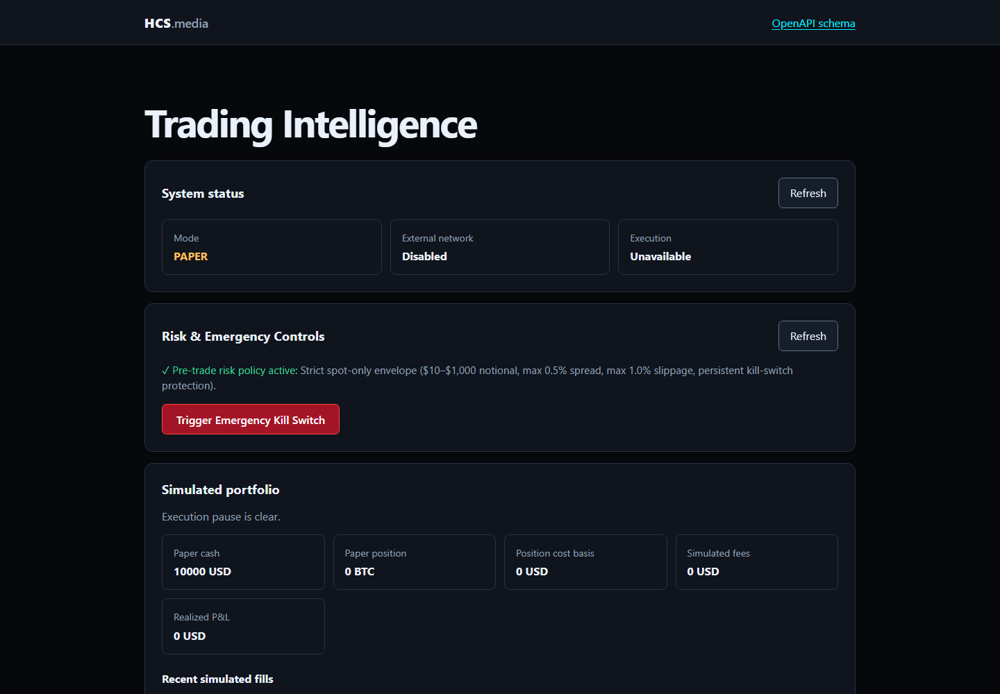
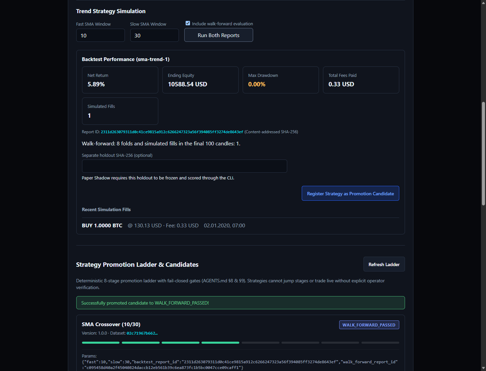
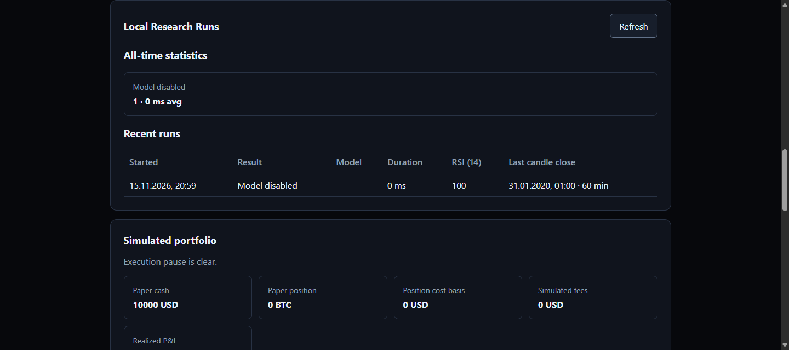
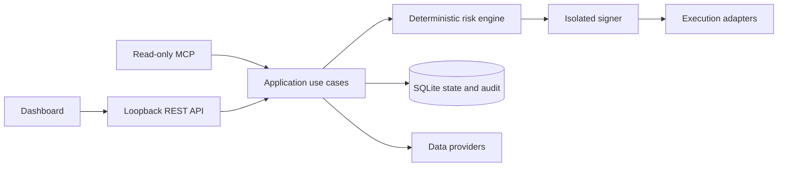

# HCS Trading Intelligence

Made with ❤️ by HCS.media.

Version 1.1.0-rc.2 is a release candidate, merged to `main` through [PR #6](https://github.com/timfromhcs/hcs-trading-intelligence/pull/6), [PR #7](https://github.com/timfromhcs/hcs-trading-intelligence/pull/7), [PR #8](https://github.com/timfromhcs/hcs-trading-intelligence/pull/8) and [PR #9](https://github.com/timfromhcs/hcs-trading-intelligence/pull/9). The tag `v1.1.0-rc.2` produced a [draft release](https://github.com/timfromhcs/hcs-trading-intelligence/releases/tag/v1.1.0-rc.2) with native single-file executables, MCPB bundles, wheel, sdist, SBOM, provenance and checksums; the static UI preview is deployed at [hcs-trading-intelligence-ui.vercel.app](https://hcs-trading-intelligence-ui.vercel.app). It is not a stable `v1.x` tag. The [release assessment](docs/V1_RELEASE_REPORT.md) lists what has and has not been verified, and the [implementation plan](docs/ROADMAP.md) lists remaining work. A static UI preview can be deployed to Vercel via `vercel.json`; it contains no backend and never exposes wallet, API or MCP functions.

## 1. What it is, and what it is not

HCS Trading Intelligence is a local-first, self-custodial crypto research application. It runs on your own machine, stores its state in a local SQLite database, serves a dashboard and a REST API on the loopback address, and ships a read-only local MCP server. It supports archived market data, indicators, backtests, a simulated (paper) portfolio, read-only wallet snapshots, strategy candidate evaluation and a tightly bounded, opt-in Kraken spot canary path.

It is not any of the following:

- An investment advisor, a signal service or a source of financial advice.
- A custodian. It never holds funds for other people and offers no hosted service.
- A tool that avoids losses. Markets gap, exchanges halt, stablecoins depeg, contracts fail and keys get stolen. Backtests and paper results do not predict live results.
- A leveraged, margin, derivatives, lending, staking or bridge product. Version 1 is spot-only.
- Air-gapped when it uses live data. Prices and news need outbound network access (see [modes](#9-modes)).

## 2. Screenshots







## 3. Feature matrix

Statuses are `Implemented` (code and tests exist and were run), `Experimental` (works under stated limits, not production-approved), `Planned` (not built) and `Not supported` (deliberately excluded).

| Area | Feature | Status |
|---|---|---|
| Platform | Loopback FastAPI service, OpenAPI schema, React dashboard | Implemented |
| Platform | SQLite storage with versioned migrations, audit events, backup | Implemented |
| Market data | Opt-in Kraken BTC/USD top-of-book quotes with quality and staleness marking | Implemented |
| Market data | Kraken hourly candle import and offline candle and CSV API | Implemented |
| Market data | CoinGecko, Binance, other exchanges, WebSocket streaming | Planned |
| News and macro | Federal Reserve monetary-policy release metadata | Implemented |
| News and macro | ECB daily USD per EUR reference rates, FRED CPI (user key) | Implemented |
| News and macro | GDELT, ECB/Bundesbank/SEC/ESMA RSS, crypto news feeds | Planned |
| Quant | RSI, SMA, EMA, MACD, ATR, Bollinger Bands (offline, deterministic) | Implemented |
| Quant | SMA backtest with fees, spread, slippage, partial fills; walk-forward; sealed holdout | Implemented |
| Quant | Strategy candidate ladder, promotion gates, forward shadow observation | Experimental |
| Paper trading | BTC/USD simulated fills, cost basis, realized PnL | Implemented |
| Wallets | Read-only balance and transaction status for ETH, SOL, BTC, LTC, DGB through your own local node | Experimental |
| Wallets | Address derivation, address-wide history, token balances | Planned |
| Signing | Encrypted keystore and isolated signer bound to risk decisions | Experimental |
| Execution | Kraken BTC/USD canary with hard limits and an expiring authorization | Experimental |
| Execution | Jupiter (Solana) and EVM router instruction inspection and allowlists | Experimental |
| Execution | Live swap execution on Solana or EVM, any BTC/LTC/DGB on-chain spend | Not supported |
| Risk | Deterministic pre-trade policy, durable kill switch | Implemented |
| MCP | Read-only local stdio server, capability tiers, invocation audit | Implemented |
| MCP | Streamable HTTP transport, side-effect tools | Planned |
| Local model | Optional llama.cpp research brief with GGUF manifest verification | Experimental |
| Skills | Five portable `SKILL.md` files | Implemented |
| Product scope | Leverage, margin, perpetuals, options, lending, staking, bridges | Not supported |
| Release | Native one-folder desktop build and checksum in CI | Experimental |
| Release | Signed or notarized installers, SBOM, provenance attestation | Planned |

### Capability flags

`GET /api/v1/system/capabilities` reports these flags. The defaults below are those of a plain `serve` start. Flags change only when you pass the matching opt-in options.

| Flag | Default | Meaning |
|---|---|---|
| `api` | true | Local REST service is up |
| `market_data` | false | Public Kraken quotes are enabled |
| `portfolio` | true | Paper portfolio reads are served |
| `paper_orders` | false | Simulated orders are accepted |
| `live_orders` | false | Live spot execution is configured |
| `mcp` | true | The local MCP server is available |
| `wallet_snapshots` | true | Stored wallet snapshots are served |

## 4. Security and financial-risk disclosure

This software is provided without warranty. It does not promise profit, and it does not promise that capital is safe. You can lose all money you place under its control. Read [SECURITY.md](SECURITY.md), the [threat model](docs/THREAT_MODEL.md) and [wallet security](docs/WALLET_SECURITY.md) before enabling anything beyond `PAPER`.

- The default mode is `PAPER`. Live order submission is off unless you pass explicit credentials and complete an interactive authorization.
- A reserve percentage in software does not protect a reserve. Only a separate cold wallet whose key never enters this application does (see [section 14](#14-risk-policy-and-hotcold-wallets)).
- Models and MCP clients never receive seeds, keys or signing access.
- Never put a mainnet seed, exchange withdrawal permission or real funds into tests or CI.

## 5. Install

### Desktop build (development builds)

Native builds are made per operating system and architecture on that platform. A Windows executable does not run on macOS or Linux. The CI archives are development builds and are not signed or notarized.

1. Download the archive for your platform and its `.sha256` file from the CI artifacts or a GitHub release.
2. Verify the checksum before extracting.
   - Windows PowerShell: `(Get-FileHash .\archive.zip -Algorithm SHA256).Hash` and compare with the checksum file.
   - macOS: `shasum -a 256 archive.zip`
   - Linux: `sha256sum -c archive.zip.sha256`
3. Extract the whole folder and run the executable. Without arguments it starts the loopback server and opens the dashboard. Keep the folder together.

Operating system warnings about unsigned binaries are expected until signing is done. See the [desktop build guide](docs/RELEASE.md).

### Python package

The wheel is published through GitHub releases only. A PyPI release has not been made.

```sh
python -m venv .venv
python -m pip install ./hcs_trader-1.1.0rc2-py3-none-any.whl
hcs-trader serve
```

Python 3.12 or later is required.

### From source

Use Python 3.12, uv 0.13.5 and Node.js 22.13 or later in the 22 series.

```sh
uv sync --locked
npm ci --prefix frontend
npm run build --prefix frontend
uv run --locked hcs-trader serve
```

Build the frontend before `uv build` so the dashboard is packaged with the wheel. Run `uv run --locked pytest` for the Python suite.

## 6. First-run setup

1. **Start the service.** `hcs-trader serve` binds `127.0.0.1:8765`. Open `http://127.0.0.1:8765`. Use `--data-dir PATH` for a separate data directory. The default is the operating system's application data folder.
2. **Data.** Run `hcs-trader serve --public-market-data` for Kraken quotes. Run `hcs-trader import-candles --interval 60`, `import-news`, `import-macro` and `import-fred --as-of YYYY-MM-DD` to fill the local archive. FRED needs your own free API key, entered at a hidden prompt. See [data sources](docs/DATA_SOURCES.md).
3. **Paper mode.** `hcs-trader serve --paper-market-data` accepts simulated BTC/USD orders using verified quotes. See [paper trading](docs/PAPER.md).
4. **Model (optional).** Everything works without a model. See [local research](docs/LOCAL_RESEARCH.md) and [section 12](#12-local-model).
5. **Wallets (optional).** Read-only balances need your own local node. See [wallets](docs/WALLETS.md). Keep long-term holdings in a cold wallet that this application never sees.
6. **Backups.** Back up the application data directory, which holds the SQLite database. Wallet seeds are not stored by the application and must be backed up by you. See [wallet security](docs/WALLET_SECURITY.md).

## 7. Command line

Common commands: `serve`, `import-candles`, `import-news`, `import-macro`, `import-fred`, `research-brief`, `research-history`, `research-watch`, `freeze-research`, `score-holdout`, `strategy-list`, `strategy-show`, `strategy-promote`, `strategy-shadow-run`, `strategy-shadow-history`, `strategy-shadow-watch`, `pause-execution`, `resume-execution`, `eth-balance`, `sol-balance`, `btc-balance`, `ltc-balance`, `dgb-balance`, `tx-status`, `kraken-validate`, `spot-canary-allow`, `spot-canary-submit`, `spot-canary-revoke`, `mcp`, `mcp-http`, `selftest`, `eval-model`, `sources`, `webfetch`, `size`, `costs`, `live-status`, `live-enable` and `live-revoke`. Run `hcs-trader --help` for the current list. The `size`, `costs`, `sources` and `eval-model` commands are side-effect-free; `size` and `costs` return `authorization: NONE`.

## 8. API and MCP

The REST API lives under `/api/v1` with the schema at `/openapi.json`. It binds to loopback only. See the [API reference](docs/API.md) for implemented and planned endpoints.

The MCP server runs over stdio and is read-only. Example host configuration for an installed environment:

```json
{
  "mcpServers": {
    "hcs-trader": { "command": "hcs-trader", "args": ["mcp"] }
  }
}
```

For a source checkout, use `"command": "uv"` with `"args": ["run", "--locked", "hcs-trader", "mcp"]` and the repository as the working directory. Tools, resources, prompts, capability tiers and the invocation audit are described in the [MCP guide](docs/MCP.md).

## 9. Modes

| Mode | Network | Orders | Status |
|---|---|---|---|
| `OFFLINE` | None. Uses archived local data only | None | Defined in the API; the default start has network access disabled |
| `DATA_ONLY` | Allowlisted read-only data sources | None | Implemented (`serve --public-market-data`) |
| `PAPER` | Public quotes for pricing | Simulated only | Implemented (default; quotes need `--paper-market-data`) |
| `LIVE` | Data plus the venue endpoint | Bounded Kraken canary only | Experimental, opt-in, off by default |

Live market data and news cannot be received air-gapped. Data-connected modes are never called offline.

## 10. Asset and network capabilities

| Network | Asset | Wallet read-only | Execution |
|---|---|---|---|
| Bitcoin | BTC | Confirmed UTXO balance through your Bitcoin Core node | Direct on-chain spend not supported. Venue spot only as Kraken BTC/USD |
| Ethereum | ETH | Balance and transaction status through your node | EVM router inspection only. Live swaps not supported |
| Solana | SOL | Balance and transaction status through your node | Jupiter instruction inspection only. Live swaps not supported |
| Litecoin | LTC | Confirmed UTXO balance through your Litecoin Core node | Direct on-chain spend not supported |
| DigiByte | DGB | Confirmed UTXO balance through your DigiByte Core node | Direct on-chain spend not supported |

Jupiter is a Solana router and the EVM router is EVM-only. Neither handles BTC, LTC or DGB, and no cross-chain bridge or atomic swap is supported. EUR is a reporting currency, not a token. USDC and EURC are not cash. Only explicitly registered, verified deployments are accepted.

## 11. Research method

Indicators are deterministic `Decimal` functions with explicit warm-up rules ([indicator definitions](docs/INDICATORS.md)). Backtests apply fees, spread, slippage and partial fills, use expanding windows, and keep a final holdout sealed until a candidate is frozen ([backtest assumptions](docs/BACKTEST.md)). Candidates move through a promotion ladder described in [strategy research](docs/STRATEGY_RESEARCH.md). A profitable backtest never authorizes live trading, and the bundled SMA strategy is educational.

## 12. Local model

A language model is optional and never an execution authority. To use one, download a GGUF file separately, record its SHA-256, license and runtime in a manifest, and run llama.cpp on loopback. The application checks the file header and digest before use and treats malformed output as `NO_TRADE`. No weights are bundled and no cloud fallback exists. See [local research](docs/LOCAL_RESEARCH.md).

## 13. Data providers

| Source | Key needed | Status | Notes |
|---|---|---|---|
| Kraken Spot public REST | No | Implemented, off by default | Rate-limited refresh and backoff |
| Federal Reserve RSS | No | Implemented | Metadata only |
| ECB SDMX | No | Implemented | Reference rates |
| FRED | Yes, your own | Implemented | Terms of use apply |
| CoinGecko, Binance, GDELT, other RSS | Varies | Planned | Not integrated |

Quotas, terms and attribution are listed per source in [data sources](docs/DATA_SOURCES.md). Public access does not grant redistribution rights.

## 14. Risk policy and hot/cold wallets

The pre-trade risk engine is deterministic code that no model, MCP client or UI can override. Limits (venue and market allowlists, notional bounds, spread and slippage caps, open-order cap, approved strategy versions, quote freshness) and the durable kill switch are described in [execution](docs/EXECUTION.md). The kill switch survives restarts and only a local operator can clear it.

A hot wallet holds a small, deliberately funded trading float that the application may use. A cold wallet holds the reserve, and its key must never be loaded here. See [wallet security](docs/WALLET_SECURITY.md) and [signing](docs/SIGNING.md).

## 15. Architecture



```text
src/hcs_trader/   service, API, MCP, risk, signing, execution, wallets, quant
src/hcs_trader/skills/   portable SKILL.md files
frontend/         React and TypeScript dashboard
tests/            pytest suite
docs/             architecture, threat model, API, wallets, data sources, ADRs
scripts/          desktop build, smoke tests, license inventory
```

More in [architecture](docs/ARCHITECTURE.md) and the [decision records](docs/ADR/0001-foundation.md).

## 16. Build, CI and release

CI runs on Windows, macOS and Linux with a locked toolchain and pinned actions, plus CodeQL and OpenSSF Scorecard. Desktop builds are native per platform. See the [release guide](docs/RELEASE.md). Signed releases, an SBOM and attestations are planned, not done. `v1.0.0` is withheld until every release criterion in AGENTS.md section 18 is evidenced.

## 17. Threat model and known limitations

See the [threat model](docs/THREAT_MODEL.md). Known limitations include:

- No signing or on-chain execution path is verified on mainnet. Wallet coverage uses regtest, devnet and Sepolia fixtures, and public Signet scans are pending.
- Public Litecoin and DigiByte testnets are not checked.
- Audit logs are append-only from the application's view, not tamper-proof against a local administrator.
- Unsigned desktop builds. No clean-VM install tests yet.
- Dependence on a local node you operate. A public RPC endpoint is a third party that can see queried addresses.

Report vulnerabilities as described in [SECURITY.md](SECURITY.md).

## 18. Contributing

See [CONTRIBUTING.md](CONTRIBUTING.md) and the [code of conduct](CODE_OF_CONDUCT.md). Notable changes are in the [changelog](CHANGELOG.md). [AGENTS.md](AGENTS.md) holds the product requirements.

## 19. License and third-party attributions

Licensed under Apache-2.0. Runtime dependencies include cryptography, defusedxml, FastAPI, httpx2, the MCP Python SDK, platformdirs and uvicorn. The frontend uses React and Vite. Market and macro data come from Kraken, the Federal Reserve, the ECB and FRED under their own terms. Model weights are separate and carry their own licenses. `scripts/license_inventory.py` lists dependency licenses.

## 20. Credits

Made with love by timfromhcs and hcsmedia.


