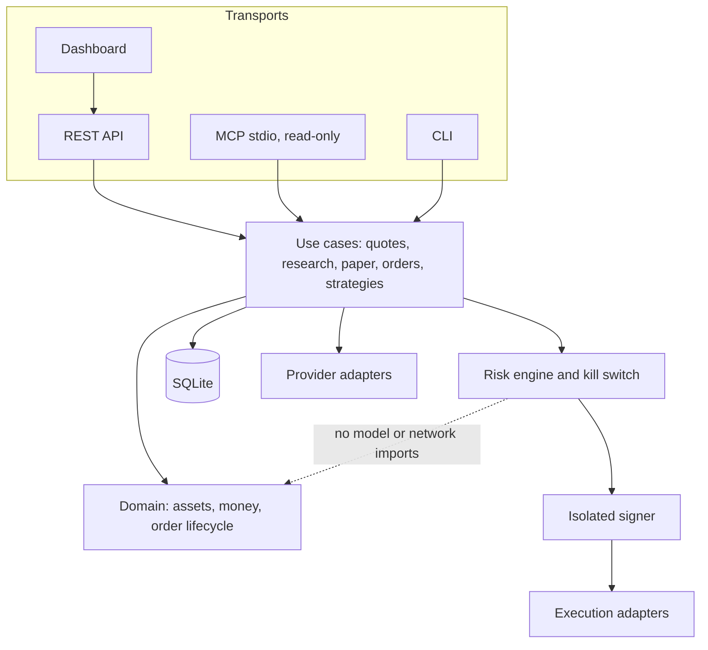
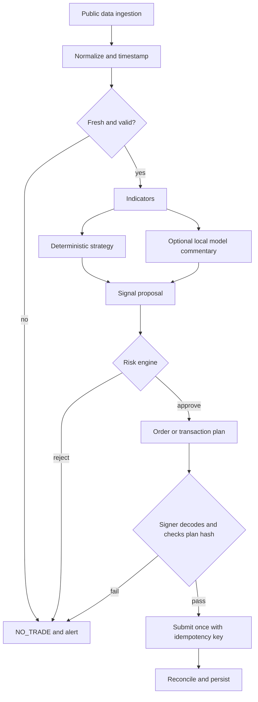

# Architecture

HCS Trading Intelligence is built as a local-first, modular monolith designed for self-custodial crypto research, paper trading, and tightly policy-bounded spot execution.

## System overview

```
+------------------------------------------------------------------------+
|                            Desktop UI                                  |
|         (React 19 + TypeScript + Vite, served locally on loopback)     |
+-----------------------------------+------------------------------------+
                                    |
                                    v HTTP (127.0.0.1:8765)
+------------------------------------------------------------------------+
|                          FastAPI REST Layer                            |
|             (Host header validation, local-origin CSRF checks)         |
+---------+------------------+------------------+------------------+-----+
          |                  |                  |                  |
          v                  v                  v                  v
+------------------+ +------------------+ +------------------+ +------------------+
| Market & News    | | Quant Research   | | Paper Ledger     | | Risk & Policy    |
| Quotes, candles, | | Indicators,      | | Balance, fills,  | | Pre-trade engine,|
| macro, Fed news  | | backtests,       | | cost-basis,      | | limits, spread/  |
| (Kraken/ECB/FRED)| | walk-forward     | | realized PnL     | | slippage caps    |
+---------+--------+ +---------+--------+ +---------+--------+ +---------+--------+
          |                    |                    |                    |
          +--------------------+--------------------+--------------------+
                                    |
                                    v
+------------------------------------------------------------------------+
|                   SQLite Audit & State Store (WAL)                     |
|           (Versioned migrations, online backups)           |
+------------------------------------------------------------------------+
                                    |
          +-------------------------+-------------------------+
          |                                                   |
          v                                                   v
+------------------------------------+ +---------------------------------+
|          Isolated Signer           | |       Execution Adapters        |
| - Scrypt KDF + AES-256-GCM keystore| | - Kraken Spot (HMAC-SHA512)     |
| - AAD binding (wallet:address:chain| | - Solana Jupiter (Allowlisted)  |
| - Deterministic plan hash audit    | | - EVM Router (Exact allowance)  |
| - Ed25519 / SECP256k1 signing      | | - Fail-closed reconciliation    |
| - Zero secret export to LLM/MCP    | | - Withdrawals strictly disabled |
+------------------------------------+ +---------------------------------+
```

## Ingestion runtime

`data/runtime.py` builds the default feed jobs and an `IngestionService` that owns the scheduler task for the app lifespan (opt-in). `data/ingestion.py` runs each source under a retry budget and circuit breaker and writes its state through `AuditStore` (`ingest_state`, schema version 20). `data/source_status.py` derives the `SourceStatus` read model that the REST, MCP and UI surfaces share.

## Architectural principles

1. **Local-First & Loopback Binding:** The application runs on the operator's machine and binds strictly to `127.0.0.1`. All mutating state endpoints require a matching local origin to prevent cross-site request forgery.
2. **Deterministic Domain Core:** Financial calculations (RSI, indicators, PnL, cost-basis, pre-trade risk) use exact `Decimal` arithmetic. Language models assist only with summarization and research briefs; they cannot alter trade limits or issue signing commands.
3. **Custody & Signing Isolation:** Long-term reserves remain physically isolated in cold wallets outside the running application. Private keys for hot trading floats are stored encrypted using Scrypt KDF and AES-256-GCM with associated data binding. Signers independently decode and validate transaction payloads against pre-approved plans before generating signatures.
4. **Spot-Only, Fail-Closed Execution:** The execution engine strictly prohibits margin, borrowing, leverage, or bridge operations. If a submission encounters an ambiguous network response or timeout, it immediately transitions to `RECONCILIATION_REQUIRED` and halts further orders until venue reconciliation confirms state.
5. **Durable Kill Switch:** The emergency pause is persisted in SQLite across process restarts and crashes. When triggered, all new order submissions and signings are blocked.
6. **Portable Agent Skills:** Structured, versioned `SKILL.md` specifications in `src/hcs_trader/skills/` (`market-research`, `strategy-lab`, `portfolio-operator`, `risk-auditor`, `release-engineer`) define strict capability tiers, trusted/untrusted data boundaries, ordered workflows, stop conditions, and explicit forbidden actions.


## Layering



Transports hold no business logic. The risk engine imports neither a model client nor a network adapter, and the signer is not reachable from MCP or from a model.

### Market registry

`domain/markets.py` is pure data: per market it holds the venue pair, accepted response names, price and quantity precision, minimum size and a status (`read_only`, `paper`, `live_allowed`). Quotes, candles, indicators and the REST and MCP read paths take a registry symbol and default to BTC/USD. The registry never authorises an action. Live submission requires `live_allowed` in the registry, the risk policy allowlist and the existing gates, and only BTC/USD carries that status. Paper execution and the paper ledger are still BTC/USD only; ETH, SOL and LTC are read-only until the ledger becomes multi-asset.

## Trading and research loop



Only the Kraken BTC/USD canary is wired to the submit step, and it needs credentials and an expiring operator authorization. Everything else ends at paper or preview. A model can add commentary but cannot approve a step.

Decisions behind this layout are recorded in the [ADRs](ADR/0001-foundation.md), starting with [signing](ADR/0004-isolated-signer.md) and the [risk engine](ADR/0006-deterministic-risk-engine.md).
